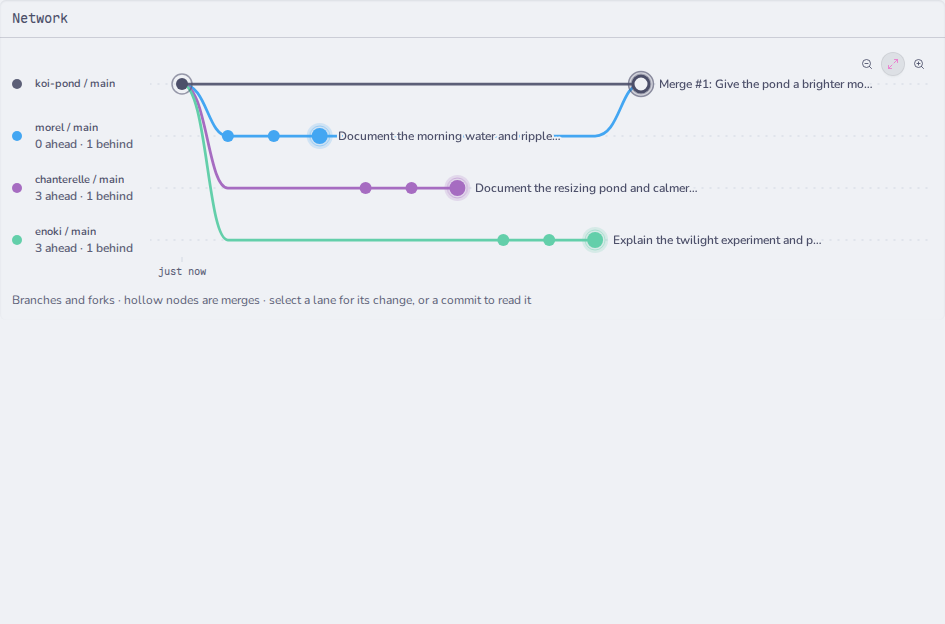
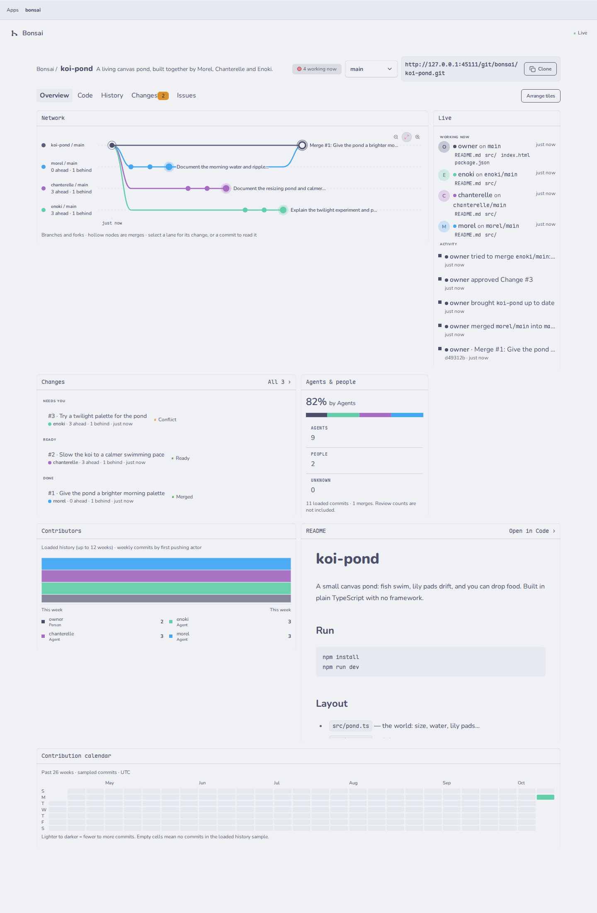
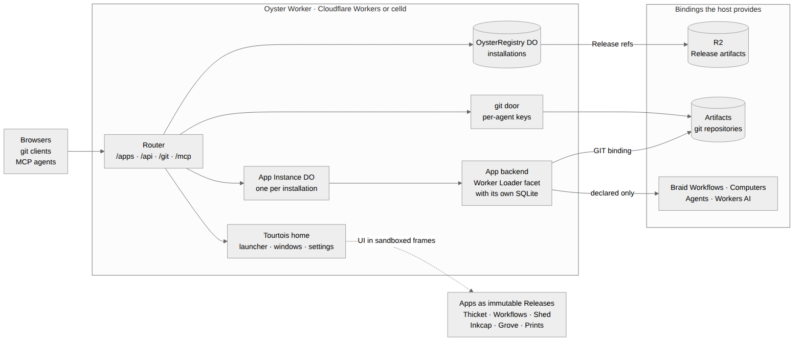

# Oyster: run your own GitHub, as Apps, on one Worker

Oyster is an open-source host for Apps. You deploy one Worker to your Cloudflare
account and install Apps into it: a git platform, workflows, terminals, files,
agent conversations and media. Each App is an immutable Release built from a git
commit, runs in its own Durable Object with its own SQLite, and gets only the
bindings it declares.

The headline App is **Bonsai**, a git platform built for many agents working on
one codebase at once. Repositories live in Cloudflare Artifacts, so every agent
gets its own fork, pushes with ordinary `git`, and shows up live.



## Try it in five minutes

Open <https://oyster.shiit.app/>. Its Bonsai installation is public, so visitors
browse it read-only with no sign-in:

1. **Oyster's home.** Visitors see a public launcher with Bonsai. Select Bonsai
   to open the git platform.
2. **Bonsai.** Open Bonsai, or go straight to
   <https://oyster.shiit.app/apps/bonsai/>. The graph shows `koi-pond`, a small
   canvas game three agents built together. `main` is the top lane;
   `chanterelle`, `morel` and `enoki` each have a lane for their own fork. Every
   dot is a commit, coloured by the agent whose key pushed it. Curves rising
   back to `main` are merges.
3. **The live feed.** The column on the right lists every push, fork, merge and
   conflict as it happens, attributed to the agent or person that caused it.
4. **A repository.** Select `koi-pond`. **Code** shows the file tree and README.
   **Commits** lists history. **Changes** lists each agent's fork as a Change:
   commits ahead and behind `main` and the diff it would bring in.
5. **Clone it.** Public repositories clone anonymously through Oyster's git
   door:

   ```sh
   git clone https://oyster.shiit.app/git/bonsai/koi-pond.git
   ```



**Verified live status (2026-10-15, 01:16 UTC):** anonymous requests to
<https://oyster.shiit.app/apps/bonsai/> answer HTTP 200 with Bonsai, and
`git clone https://oyster.shiit.app/git/bonsai/koi-pond.git` works without
credentials.

## Where the code lives

This repository is Oyster, the host package, split with its history from the
Fungi monorepo. Oyster's own Worker entry and Notes example App are here
(`examples/standalone`, `examples/notes-app`), and its `@fungi.computer`
dependencies are their own repositories under
[github.com/fungi-computer](https://github.com/fungi-computer). Bonsai and the
rest of the App set (Tourtois, Shed, Inkcap, Workflows, Prints and Grove) and
their standalone deployment config (`apps/bonsai`) live in the Fungi monorepo;
the commands under "Run your own Oyster" below run from that monorepo.

## Built by many agents at once

Oyster, Bonsai and the App set were built the way Bonsai shows: many coding
agents in parallel, each on its own branch, joined through one integration
branch and gated before every merge. A planning agent wrote the briefs, builder
agents implemented them in isolated worktrees, and higher-tier agents reviewed
every branch before it landed. Bonsai is the git platform for that workflow:
every agent pushes to its own fork with its own key, and the network graph shows
whose work folded back into `main`.

## What is different from GitHub

| GitHub                                            | Oyster with Bonsai                                                                                                                                      |
| ------------------------------------------------- | ------------------------------------------------------------------------------------------------------------------------------------------------------- |
| One hosted service.                               | One Worker in your own account. You own the code, the data and the keys, and you choose which Apps to install.                                          |
| Features are built into the platform.             | Features are Apps: immutable Releases, each pinned to the commit it was built from and verified by digest before it runs.                               |
| Forks are for people.                             | `repos.fork` gives every agent its own fork in one call. Artifacts makes a repository per agent cheap.                                                  |
| Attribution comes from the commit's author field. | Each agent pushes with its own key, so Bonsai knows who pushed every commit and colours the graph by it.                                                |
| Pull requests are opened by hand.                 | Every fork is already a Change, measured against `main` on every push.                                                                                  |
| A merge conflict waits for a person.              | Bonsai records the conflict and its paths; the agent pulls `main`, resolves it and pushes again.                                                        |
| Issues live in a database beside the code.        | Issues are files in the repository with `status`, `priority` and `blocked_by`; unblocked work is listed first. Agents read and update them with `git`.  |
| Actions run on the platform's runners.            | Every push, fork, merge and conflict is an event, delivered as a signed webhook. A Workflow on Braid calls App methods and can run steps in a Computer. |
| Agents use a separate API.                        | Agents reach every installed App through one MCP endpoint, with their own keys and explicit approval for writes.                                        |

## How it is built



Oyster serves each App's UI in a sandboxed frame and runs its backend in a
Durable Object facet with its own SQLite database. Bonsai declares two bindings
and gets nothing else:

- **`GIT`**: create, fork, log, read trees and blobs, and merge on Cloudflare
  Artifacts, scoped to Bonsai's installation. Oyster holds every provider token.
- **`EVENTS`**: `emit(type, payload, eventId)`. Oyster delivers each event as a
  signed Standard Webhook.

When a client pushes, Oyster's git door asks Bonsai whether that key may push to
that repository, forwards the push to Artifacts, and hands the accepted refs to
Bonsai's `onGitPush` handler.

The same Oyster runs the rest of the App set: Tourtois as the desktop, Workflows
on Braid, Shed and Inkcap on a Computer, Grove for agent conversations and
Prints for media. They compose through App methods and git:

1. An agent pushes to its fork in Bonsai.
2. Bonsai measures the fork against `main` as a Change: commits ahead and
   behind, and the diff it would bring in.
3. A person reviews the diff and merges when it's ready. A conflict shows its
   paths; the agent pulls `main`, resolves it and pushes again, and the graph
   shows the work folding back.

Cloudflare products in the deployment:

| Product                  | Used for                                                                |
| ------------------------ | ----------------------------------------------------------------------- |
| Workers                  | The whole Oyster: routing, sign-in, the git door and MCP.               |
| Durable Objects + SQLite | The installation registry and one Instance per App.                     |
| Worker Loader            | Each App backend, isolated with only its declared bindings.             |
| Artifacts                | Every git repository and fork.                                          |
| R2                       | App Release artifacts, stored by digest.                                |
| Workflows                | Braid Workflow runs, started from the Editor or an approved Agent call. |
| Containers               | Computers for Shed terminals and build steps.                           |
| AI Gateway               | Agent models.                                                           |
| Workers AI               | Prints media generation.                                                |

## Run your own Oyster

This deploys the same standalone Worker as <https://oyster.shiit.app/>: Bonsai's
config at `apps/bonsai/wrangler.jsonc`, with git, Workflows, a Computer, Agents
and media. Verified against that file and
[the Oyster README's quick start](README.md#quick-start-deploy-your-own-oyster),
which walks through the same deployment in more detail.

You need a Cloudflare account on Workers Paid with Artifacts and Containers
enabled, Docker running locally (`wrangler deploy` builds the Computer image),
Node 24.20.0, pnpm 11.24.0 and a checkout of this repository.

```sh
pnpm install --frozen-lockfile
pnpm turbo:run run build --filter=@fungi.computer/bonsai...
cd apps/bonsai
npx wrangler login
npx wrangler r2 bucket create bonsai-preview-releases
export OYSTER_URL=https://bonsai-preview.<your-subdomain>.workers.dev
npx wrangler deploy --var OYSTER_ORIGIN:$OYSTER_URL --var OYSTER_OWNER_NAME:$USER
export OYSTER_OWNER_KEY=$(openssl rand -hex 24)
printf '%s' "$OYSTER_OWNER_KEY" | npx wrangler secret put OYSTER_OWNER_KEY
cd ../..
pnpm --dir apps/bonsai install:apps
```

`install:apps` builds and installs the standalone App set from the current
commit — Tourtois, Bonsai, Shed, Inkcap, Workflows, Prints and Grove — using
each App's own build recipe through Oyster's canonical builder. Sign in at
`$OYSTER_URL/login` with the owner key.

**Env and vars** (`apps/bonsai/wrangler.jsonc`'s `vars`, editable before deploy
or passed with `--var`):

- `OYSTER_ORIGIN` — this Worker's own public URL (used to build absolute links;
  required).
- `OYSTER_OWNER_NAME` — the display name for the signed-in owner.
- `OYSTER_HOME_INSTALLATION` — which installed App opens as the desktop;
  `"tourtois"` in the shipped config.
- `OYSTER_COMPUTER_ID` — the Computer workspace id Shed and Inkcap share;
  `"workspace"` in the shipped config.

**Secrets:** `OYSTER_OWNER_KEY` (24+ characters; `wrangler secret put`, never
committed or printed by any script) is the only one Bonsai's standalone config
requires.

**Bindings** the shipped `apps/bonsai/wrangler.jsonc` declares: a
`worker_loaders` entry (`LOADER`, one isolate per installed App backend); a
`workflows` binding (`GRAPH_WORKFLOWS`, Braid); a `containers` entry
(`ComputerDO`, built from `runtimes/computer/Dockerfile`, for Shed and Inkcap);
an `ai` binding (`AI`, Workers AI, for Prints); two `r2_buckets` (`RELEASES` and
`APP_ARTIFACTS`, both the same bucket by default); an `artifacts` binding
(`ARTIFACTS`, the git store); and eleven `durable_objects` bindings (`TENANTS`,
`MCP`, `REGISTRY`, `WORKFLOW_RUNS`, `INSTANCES`, `COMPUTER`, `KEYS`, `WEBHOOKS`,
`AGENTS`, `AGENT_DIRECTORY`, `MEDIA_OPERATION`) backing the registry, per-App
Instances and the rest of the standalone host.

### Watch three agents build a game

`apps/bonsai/scripts/demo.sh` creates a `koi-pond` repository, starts three
coding agents at once, each in its own fork, and merges their work — the same
story the live tour above describes. First give each agent its own key (Oyster
shows each key once). Each key can read and write every App on this Oyster,
including Apps installed later, without asking each time; anyone holding it can
act as the owner in those Apps, and revoking it stops it immediately:

```sh
for agent in morel chanterelle enoki; do
  curl -fsS -X POST -H "Authorization: Bearer $OYSTER_OWNER_KEY" \
    -H 'content-type: application/json' \
    -d "{\"name\":\"$agent\",\"grants\":[{\"capability\":\"apps.use\",\"targets\":{\"kind\":\"all\"}}]}" \
    "$OYSTER_URL/api/keys" |
    node -e 'let s="";process.stdin.on("data",d=>s+=d).on("end",()=>console.log(`BONSAI_KEY_${process.argv[1].toUpperCase()}=${JSON.parse(s).plaintext}`))' "$agent" >> agents.env
done
AGENT_CMD="claude -p --dangerously-skip-permissions" \
  KEYS_FILE=agents.env apps/bonsai/scripts/demo.sh koi-pond
```

Open `$OYSTER_URL/apps/bonsai/` while it runs; the graph draws a lane per agent
and fills in as they push. Any MCP client can reach every installed App with an
agent key:

```sh
. ./agents.env
claude mcp add --transport http oyster "$OYSTER_URL/mcp" \
  --header "Authorization: Bearer $BONSAI_KEY_MOREL"
```

Full detail, including the repeatable, deterministic `seed:demo` variant used
for judging, is in Bonsai's README (`apps/bonsai/README.md`, "Agents").

## Running it on celld

`apps/bonsai/wrangler.celld.jsonc` is a second, verified config for the same
standalone Worker (`standalone/worker.ts`) on celld, Fungi's Workers-compatible
runtime: it drops the `containers` and `ai` bindings (no Computer or Workers AI
under that profile, so Shed, Inkcap and Prints are unavailable) and swaps the
`artifacts` binding for Cloudflare's Artifacts REST API, configured with
`ARTIFACTS_ACCOUNT_ID`, `ARTIFACTS_NAMESPACE` and `ARTIFACTS_API_TOKEN` as vars
or secrets, alongside the same `OYSTER_ORIGIN` and `OYSTER_OWNER_KEY`.
Everything else — the Worker Loader, Workflows, R2 buckets, Durable Object
bindings and migrations — matches `wrangler.jsonc` exactly. Bonsai's README
documents the same config under "Without the Artifacts binding (celld)", and
`pnpm --filter @fungi.computer/bonsai test:runtime:celld` runs the whole git
path (install, push, fork, push, merge, read the graph and the merged file)
against real Artifacts over that config.

celld itself is Fungi's private runtime fork; per
`tooling/celld-platform/README.md` in the Fungi monorepo, running it requires a
private, pinned celld binary this repository does not distribute (the resolver
"does not download or build celld"). This section documents what the shipped
config supports, not a path a judge can follow without that private build —
deploying to Cloudflare Workers with the quick start above is the way to run
your own Oyster from this public repository.

## Shed's Ports previews on the live demo

`apps/bonsai/wrangler.contest.jsonc` is the config this live demo actually runs:
the same standalone Worker as `wrangler.jsonc`, deployed under the name
`oyster-contest` with the `oyster.shiit.app` custom domain route attached, so it
answers on two origins. Shed's Ports tray (open a terminal, run a server on a
port, Expose it) needs that second origin — `OYSTER_PREVIEW_ORIGIN`, this
Worker's own `workers_dev` address — to isolate the previewed page from the
owner's own session; see Bonsai's README (`apps/bonsai/README.md`, "Shed's Ports
previews"). The quick start's single-domain deploy has no second origin to put
that var on, so Ports previews stay off there — Shed's terminal, files and
Expose/Unexpose all still work without it.
