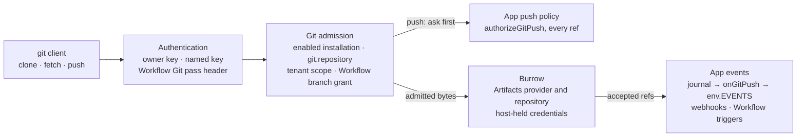

# Oyster (`@fungi.computer/oyster`)

Oyster is an open-source host for Apps: deploy one Worker to your Cloudflare
account and run your own git platform, workflows, terminals, files and agents as
installable Apps, each with its own database.


Bonsai, the git platform for many agents at once, is Oyster's headline App. Try
a live Oyster at <https://oyster.shiit.app/>; [CONTEST.md](CONTEST.md) is the
five-minute tour and the comparison with GitHub.

An Oyster is one Worker. It opens into Tourtois, a desktop with a launcher,
windows and settings, and every App you install appears there:

- **Bonsai** hosts git repositories on Cloudflare Artifacts. Each agent gets its
  own fork and pushes with ordinary `git`.
- **Workflows** runs typed graphs of App methods on Braid
  (`@fungi.computer/braid`), started by a push, a webhook or a schedule.
- **Shed** opens a terminal on a Computer, a Linux workspace in a Cloudflare
  Container.
- **Inkcap** edits files on a Computer, **Grove** holds conversations with
  agents and **Prints** generates images and video with Workers AI.

Every App is an immutable Release built from an exact git commit. Its UI runs in
a sandboxed frame, its backend runs in its own Durable Object with its own
SQLite, and it receives only the bindings it declares. Agents reach every
installed App through one MCP endpoint. The same Worker runs on Cloudflare
Workers and on celld, a Workers-compatible runtime you can host yourself.

## Hand this to your agent

Paste this prompt into a coding agent (Claude Code, Codex or any other) to have
it set up a local Oyster, install an App, connect over MCP and add Git:

```text
Set up Oyster for me. Oyster is not on npm yet: clone <repository-url> and
follow packages/oyster/docs/site/agent-quickstart.mdx step by step. Run each command
exactly as written, compare its output with the expected output, and use the
"If it fails" notes before improvising. Stop and ask me before step 8 (deploy).
```

The guide is [`docs/site/agent-quickstart.mdx`](docs/site/agent-quickstart.mdx),
also served as the package site's Agent quick start page and listed first in its
`/llms.txt`. It needs Node 24.20.0, pnpm 11.24.0 and Git; a Cloudflare account
matters only for the final deploy step.

## Why Oyster

**Apps are Releases with provenance.** `packRelease` builds an App from one
commit and records it as `sourceRevision: git:<sha>`. Every artifact is
addressed by its SHA-256 digest, and Oyster verifies each digest before it
installs or replaces a Release. Replacing a Release keeps the App's data;
deleting it purges the data and leaves a tombstone.

**Every App is isolated.** An App's backend loads through a Worker Loader into
its own Durable Object facet with its own SQLite database. It has no ambient
network access. It receives only the bindings its Release declares (`GIT`,
`EVENTS`, Computer, agent, workflow, media), and Oyster checks that declaration
again on every request. App pages are served with a deny-by-default Content
Security Policy inside a sandboxed frame.

**Git is a binding.** An App that declares `git.repository` gets `env.GIT`:
create, fork, log, read and merge on Cloudflare Artifacts, scoped to its
installation. People and agents push with ordinary `git` through Oyster's git
door using their own keys; the host keeps every provider credential. Each
accepted push reaches the App's `onGitPush` handler and can start a Workflow or
a signed webhook.

**Agents are first-class callers.** `POST /mcp` serves one MCP endpoint for the
whole Oyster. Every installed App's methods appear as typed `env.<APP>` modules
that an agent discovers and calls from code; a dotted method is a nested
property, e.g. `env.BONSAI.repos.list({})`. Writes need explicit approval. Each
agent has its own key, so every push and call is attributed.

**Workflows compose Apps.** Workflows stores each graph in git, so a commit is a
version. Braid compiles the graph to a plan with a digest and runs it on
Cloudflare Workflows. Steps call App methods and can run a sandboxed Code node
or a step in a Computer.

**Computers are ordinary capabilities.** A Computer is a durable workspace with
a Container backing. Shed opens its terminal, Inkcap edits its files and port
previews serve what it runs on signed hostnames. Apps reach it only through the
`computer.*` capability they declare.

**The desktop is a trusted shell.** Tourtois is installed like any other
Release, but your Oyster renders its home installation as the top-level page,
with every permission you have as owner. Each App it opens still runs in its own
sandboxed frame inside that App's window. Pick a shell you trust: it can do
anything you can.

## Architecture


| Piece             | Owns                                                                                       |
| ----------------- | ------------------------------------------------------------------------------------------ |
| Router            | Sign-in, `/apps/<installation>/` pages, App methods, owner `/api/*` routes and `/mcp`.     |
| `OysterRegistry`  | The installation list: which Release each installation runs, and its visibility.           |
| R2                | Release artifacts, stored by digest.                                                       |
| App Instance      | One Durable Object per installation: lifecycle, owner state and the backend facet.         |
| Backend facet     | The App's own code and SQLite database, loaded through the Worker Loader.                  |
| git door          | Smart-HTTP `clone`, `fetch` and `push`, admitted per key and forwarded to Artifacts.       |
| Tourtois          | The trusted shell: launcher, windows, menus and settings, rendered as the top-level page.  |
| Platform bindings | Braid Workflows, Computers, Agents and Workers AI, offered only to Apps that declare them. |

The diagram source is
[`docs/media/architecture.mmd`](docs/media/architecture.mmd).

## Quick start: deploy your own Oyster

This deploys the same Oyster as <https://oyster.shiit.app/>: Bonsai's standalone
Worker, with git, Workflows, Computers, Agents and media.

You need:

- a Cloudflare account on Workers Paid, with Artifacts and Containers enabled;
- Docker running locally (`wrangler deploy` builds the Computer image);
- Node 24.20.0, pnpm 11.24.0 and Git;
- a checkout of this repository.

Build Oyster, Bonsai and everything they use, from the repository root:

```sh
pnpm install --frozen-lockfile
pnpm turbo:run run build --filter=@fungi.computer/bonsai...
```

The whole Worker is Oyster's git-enabled entry plus the slots this deployment
fills. Without git, agents or Computers, the Worker entry is
[`examples/standalone/worker.ts`](examples/standalone/worker.ts): the default
handler plus four classes. `OysterRegistry`, `OysterInstance` and `OysterMcp`
are the Durable Objects its `wrangler.jsonc` binds; `OysterBinding` is the one
entrypoint every App binding in every invocation frame is minted from
(`env.APP_STORAGE`, `env.BACKGROUND`, `env.APPS` and the rest).

```ts title="worker.ts"
import { createOysterWorker } from "@fungi.computer/oyster/workers";

export {
  OysterBinding,
  OysterInstance,
  OysterRegistry,
  OysterMcp,
} from "@fungi.computer/oyster/workers";

export default createOysterWorker();
```

Create the Release bucket and deploy. Your Worker's address is
`https://bonsai-preview.<your-subdomain>.workers.dev`; your workers.dev
subdomain is on the Workers & Pages overview in the Cloudflare dashboard.

```sh
cd apps/bonsai
npx wrangler login
npx wrangler r2 bucket create bonsai-preview-releases
export OYSTER_URL=https://bonsai-preview.<your-subdomain>.workers.dev
npx wrangler deploy --var OYSTER_ORIGIN:$OYSTER_URL --var OYSTER_OWNER_NAME:$USER
```

Set `OYSTER_ORIGIN` and `OYSTER_OWNER_NAME` in `wrangler.jsonc` instead if you
deploy again later; every deploy replaces the Worker's variables.

Choose an owner key and store it as a secret:

```sh
export OYSTER_OWNER_KEY=$(openssl rand -hex 24)
printf '%s' "$OYSTER_OWNER_KEY" | npx wrangler secret put OYSTER_OWNER_KEY
```

Build and install the standalone App set from the current commit:

```sh
cd ../..
pnpm --dir apps/bonsai install:apps
```

This uses each App's existing recipe through Oyster's canonical builder and
installs Tourtois, Bonsai, Shed, Inkcap, Workflows, Prints and Grove. Running
the command again replaces their Releases and keeps each installation's data.
The owner key is read from `OYSTER_OWNER_KEY`; the command never prints it.

Open `$OYSTER_URL/login`, sign in with the owner key, then open `$OYSTER_URL/`.
The standalone config selects `tourtois` as `OYSTER_HOME_INSTALLATION`: Tourtois
opens as the desktop, with the six other Apps in its launcher.

### Watch three agents build a game

`apps/bonsai/scripts/demo.sh` creates a `koi-pond` repository, starts three
coding agents at once, each in its own fork, and merges their work. When a merge
conflicts, it sends that agent back to resolve the conflict. First give each
agent its own key; Oyster shows each key once. Each key can read and write every
App on this Oyster, including Apps installed later, without asking each time;
anyone holding it can act as the owner in those Apps, and revoking it stops it
immediately:

```sh
for agent in morel chanterelle enoki; do
  curl -fsS -X POST -H "Authorization: Bearer $OYSTER_OWNER_KEY" \
    -H 'content-type: application/json' \
    -d "{\"name\":\"$agent\",\"grants\":[{\"capability\":\"apps.use\",\"targets\":{\"kind\":\"all\"}}]}" \
    "$OYSTER_URL/api/keys" |
    node -e 'let s="";process.stdin.on("data",d=>s+=d).on("end",()=>console.log(`BONSAI_KEY_${process.argv[1].toUpperCase()}=${JSON.parse(s).plaintext}`))' "$agent" >> agents.env
done
```

Then run the demo with the agent harness you have. Each agent runs in its own
clone, so this uses Claude Code:

```sh
AGENT_CMD="claude -p --dangerously-skip-permissions" \
  KEYS_FILE=agents.env apps/bonsai/scripts/demo.sh koi-pond
```

Open `$OYSTER_URL/apps/bonsai/` while it runs. The graph draws a lane per agent
and fills in as they push.

Any MCP client can call every installed App with an agent key. For Claude Code:

```sh
. ./agents.env
claude mcp add --transport http oyster "$OYSTER_URL/mcp" \
  --header "Authorization: Bearer $BONSAI_KEY_MOREL"
```

### Prove it locally

These checks run a real Oyster under workerd and under celld, install the Notes
example App, call its methods and drive its UI in a browser:

```sh
pnpm --filter @fungi.computer/oyster test:standalone
pnpm --filter @fungi.computer/oyster test:standalone:celld
```

To start a new App from this checkout, copy
[`examples/notes-app`](examples/notes-app): a UI, typed backend methods and
SQLite state. "Pack an App" under Run your own Oyster builds it into a Release
and installs it with the same recipe `test:standalone` uses.

## Install or set up

To use Oyster as a library in your own host, build the source workspace and
check its tarball:

```sh
pnpm install --frozen-lockfile
pnpm turbo:run run build --filter=@fungi.computer/oyster
pnpm --filter @fungi.computer/oyster test
pnpm --filter @fungi.computer/oyster run pack
pnpm --filter @fungi.computer/oyster run stranger
```

Oyster depends on `@fungi.computer/agar` (the App RPC contract),
`@fungi.computer/puffball` (Releases and durable backends),
`@fungi.computer/mycelium` (the MCP and codemode door) and the other
`@fungi.computer` packages listed on the Install page. A standalone release
needs that closure published too.

## Run your own Oyster

Agent runtime composition belongs to the deployable host. Bonsai's
`standalone/agents.ts` composes stock Shiitake Durable Objects and the Agent
fleet, with `oysterAppMethods` supplying the installed App catalog. Oyster
exports that catalog and its capability slots without an Agent runtime
dependency.

`@fungi.computer/oyster/workers` is a complete single-owner App server; its
Worker entry is the `worker.ts` in the quick start.
`examples/standalone/wrangler.jsonc` declares its bindings: a Worker Loader, an
R2 bucket for Releases and three SQLite Durable Objects (`REGISTRY`, `INSTANCES`
and `MCP`). Set the owner key as a secret (`OYSTER_OWNER_KEY`, 24+ characters)
and deploy with `wrangler deploy`; the same config runs under `celld dev`. Sign
in at `/login`.

Pack and install an App with `@fungi.computer/oyster/pack`: `packRelease` turns
an exact Git commit and a canonical build recipe into a Release with immutable
artifacts, and `installRelease` uploads it. Each installed App gets:

- its UI at `/apps/<installation>/`, in a sandboxed frame connected through
  Agar's `app.backend` capability;
- its methods at `POST /apps/<installation>/methods/<name>` (JSON in and out);
- its own SQLite state in its Instance's `app` facet.

`createOyster(host)` from `@fungi.computer/oyster/host` is the same server over
your own adapters (`auth`, `artifacts`, `installations`, `instances`, `mcp`,
`capabilities`).

### Add Git to your host

Git is one optional field of the typed host: `host.git`. When it is present,
`createOyster` mounts the git door at `/git/<installation>/<repo>.git`, and
people and agents `clone`, `fetch` and `push` with ordinary git. Nothing else in
the host changes.

There are two ways to get it:

- **Use one Git root.** `oysterGitRoot(options)` from
  `@fungi.computer/oyster/workers-git` is the whole composition: the git door
  plus tenancy, Agents and their owner-only approval routes, workspace and
  capability slots, the page script and the home App. Its `hostFor(env, scope)`
  is the only way a tenant host is built. Pass the root to
  `createOysterGitWorker` for HTTP and to `createOysterGitMcpOwner` for MCP, and
  return `root.hostFor(this.env, scope)` from your `OysterGitInstance` subclass,
  so HTTP, MCP and background wakes share one composition. `tenancy` is
  required; a single-owner root passes `ownerOrKeyTenancy`, so the owner key and
  named keys sign git in. `examples/git/worker.ts` is that root in one short
  file, and Bonsai's `standalone/worker.ts` is a real multi-door caller. Its
  `wrangler.jsonc` adds the `ARTIFACTS` binding and the `KEYS` and `WEBHOOKS`
  Durable Objects.
- **Set `host.git` on your own host.** Keep your own `createOyster(host)`
  composition and set `git: oysterWorkerGit(env, { scope })` and
  `ownerRoutes: gitAdminRoutes(env, scope)` for `/api/keys` and `/api/webhooks`,
  with the tenant `scope` your host selected.

The git root, from Workers:

```ts title="worker.ts"
import type { TenantScope } from "@fungi.computer/oyster/tenant";
import {
  createOysterGitMcpOwner,
  createOysterGitWorker,
  OysterGitInstance,
  oysterGitRoot,
  ownerOrKeyTenancy,
  type OysterGitWorkerEnv,
} from "@fungi.computer/oyster/workers-git";

const root = oysterGitRoot<OysterGitWorkerEnv>({ tenancy: ownerOrKeyTenancy });

export class OysterMcp extends createOysterGitMcpOwner(root) {}

export class OysterInstance extends OysterGitInstance {
  protected hostFor(scope: TenantScope) {
    return root.hostFor(this.env, scope);
  }
}

export default createOysterGitWorker(root);
```

`examples/git/worker.ts` adds the Durable Object exports and the git
`OysterBinding` entrypoint, whose table also serves `env.GIT` and `env.EVENTS`.
`pnpm --filter @fungi.computer/oyster test:git-door` runs that exact file on
workerd against real bare repositories: the owner pushes with `git`, a named
agent key's push is refused by the App's policy with Git's own `ng` report, both
keys clone, and the accepted push reaches the App's `onGitPush`.

Each layer owns one decision:



- **Authentication** is the host's own `auth`. The owner key is a Bearer token;
  a named key may also be the Basic password from a git credential helper. A
  Workflow Git pass (a `wgp.` Bearer header, never in a URL) goes only to
  `host.git.workflowPass`; without that port it admits nothing. Anonymous
  requests read only public installations and never push.
- **Git admission** reopens the live installation before every provider call: it
  must be enabled and its Release must declare `git.repository`. The tenant
  scope prefixes every repository name (`<installation>--<repo>` for the default
  tenant), so an installation reaches only its own repositories. A Workflow
  writer may push only the branches its grant names.
- **The App's push policy** answers `authorizeGitPush` for every ref update
  before any bytes reach the provider. One refusal rejects the whole push with
  Git's native `ng` report. Unsupported receive-pack commands, including signed
  push certificates, fail closed.
- **Burrow** owns the provider and the repository. The host's Artifacts adapter
  mints short-lived credentials through it and forwards the admitted smart-HTTP
  exchange (up to 64 MiB per request); the App sees repository names, git
  objects and its own events, never a credential or remote.
- **App events** start from the accepted-ref journal. Delivery calls the
  selected Instance's `onGitPush` when the Release declares
  `receives: ["git.push"]` and `git.repository`. The App emits typed events
  through `env.EVENTS`: Oyster delivers them as signed Standard Webhooks, and a
  host with Workflows (the Hub, or Bonsai's standalone root) starts the Workflow
  triggers armed on that event.

Agent approval stays owner-direct in both compositions: the approval routes are
owner routes, refuse App-origin requests, and are never an `OysterCapability` an
App can be granted.

#### Git bindings, journal and lower-level ports

A Release's `backend.bindings` determines whether its App gets `env.GIT`
(Cloudflare Artifacts, scoped to its installation; credentials stay in the host)
or `env.EVENTS` (delivered as Standard Webhooks to subscriptions the owner
creates at `/api/webhooks`). Each binding enforces its declared operations.
`await env.GIT.cloneUrl(repo)` returns the host-issued clone URL; an undeclared
binding grants nothing. Declaration changes invalidate the loader entry even
when the backend bytes stay the same. Agents push with keys from `/api/keys`.

Hosts compose one `createAdmittedGit` with an installation-scoped store, live
host grants, the App's typed `authorizeGitPush` policy and an accepted-ref
journal. `GitWriter`, `GitPushQuestion`, `GitPushVerdict` and accepted facts
come from `@fungi.computer/agar/git`; the shared wire parser is in
`agar/git-wire`.

An App's own `GIT` binding uses `admitted.binding(onBehalfOf)`. Its writer is
`installation`, with the host-attested caller retained in `onBehalfOf`. These
writes skip the App's external-push policy, retain live host admission and enter
the same accepted-ref journal. The journal records only refs accepted by the
provider and commits before the exchange is acknowledged. Redelivery keeps the
complete original fact and `eventId`; handlers record that ID with their
effects.

`createGitPushJournal` composes the standalone Instance's SQLite owner with
Carrier delivery and an alarm hook. Its accepted fact, ref tips and Carrier send
commit together; Carrier retains delivery attempts across restarts and retries.
The Hub composes its ref journal and `TeamPost.sendGitPush` in one host
transaction. Neither HTTP routing nor the provider adapter creates a second push
fact.

`createGitDoor` from `@fungi.computer/oyster/git` accepts the host's
`authenticate`, `isPublic` and `git` ports. `authenticate` receives the request
and the exact installation, repository and read/write scope it names. The last
returns an `AdmittedGit`; the door forwards reads to `.read` and pushes to
`.push`. Provider credentials stay inside the storage adapter. `createOyster`
builds these ports from `host.auth`, `host.installations` and `host.git`, so
most hosts set `host.git` and never call `createGitDoor` directly.

A host that mints Workflow Git passes supplies `workflowGitPass` in
`oysterGitRoot` or `oysterWorkerGit` options. A pass travels only as an
`Authorization: Bearer` header starting with `workflowGitPassPrefix` (`wgp.`) on
the ordinary credential-free door URL; it is never part of a URL. That header is
admitted only by the port, for one repository and scope, as the arming member
under the Workflow's branch grant, and never as a session or key. Pushes outside
those branches are refused before the App's push policy runs.

### Provide App capabilities

Each `OysterCapability` supplies its Agar `id` and `version`, a mount `base`,
relative Hono `routes`, an `admits(principal, installation)` decision, and
`methods`. Each method descriptor has `kind`, `method` (HTTP method), and `path`
(relative route). `CapabilityMethodKind` is `json | transport | read | write`:
JSON calls return decoded data, transports return Fetch handles, and
reads/writes return Agar's stream handles.

Method paths may contain named parameters, such as `:agentId/sessions`. Oyster
uses `path-to-regexp` to compile input fields into those parameters; remaining
scalar fields become query parameters for GET and handle calls. Other JSON calls
keep their remaining fields in the request body. Transport handles append their
Fetch pathname below that resolved route and may declare `method: "ANY"` to
retain the request's HTTP method. JSON results, including Agar's
`{ kind: "pending", retryAfterMs }`, reach the App unchanged; the page does not
poll on the App's behalf.

For example, a directory method uses
`{ kind: "json", method: "GET", path: "list" }`; a file read uses
`{ kind: "read", method: "GET", path: "content" }`. `fileCapabilities(source)`
from `@fungi.computer/oyster/files` supplies the three file contracts over the
existing `/files/` GET, PUT and POST routes.

The page offers a capability only when the installed Release declares its ID and
`admits` allows the principal. Visitors receive none. Every route request also
rechecks that declaration and admission using the `X-Oyster-Installation` header
set by the page; a read grant does not authorize the write route sharing its
file mount.

Consent approves capabilities, like OAuth scopes. An App upgrade may add a
method that uses an already-approved capability without asking again. A new
capability always needs approval. Release selection intersects stored operation
and resource approvals; it never adds a grant. Every Worker call receives only
the bindings allowed by that method's declared `requires`, rather than all the
App's approved capabilities.

The `agent.manage` consent wording is **Can create Agents; write abilities need
your approval.**

The `apps.call` permission also shows the declared target Apps and methods. Its
route approvals retain those exact pairs: adding or renaming a target method
needs owner approval. On Oyster these page calls run as the signed-in member
through the target App's ordinary method gate; Agents, keys and visitors cannot
use this path. The target receives its own grants, never the caller App's
grants. The Hub shows the same consent list but does not offer this page
capability.

### Connect an agent over MCP

Connect your MCP client to `https://<your-oyster>/mcp` with
`Authorization: Bearer <key>`. Installed App methods are available through
`execute` as `env.<APP>`; a dotted method is a nested property, e.g.
`env.BONSAI.repos.list({})`; discover them with `forage.search` and
`forage.describe`. A key's or Agent's App writes run under the owner's stored
approval of its App tools (recorded when the owner creates the key), so a
headless client such as `claude -p` can write. That approval already covers
every App on this Oyster, including ones installed after the key existed, with
no per-call prompt; anyone holding the key can act as the owner in those Apps,
and revoking the key is what stops it. Every other write, including the owner's
own calls, requires a client that supports form elicitation and explicit
approval; anonymous callers are refused.

When the host has a Computer, the catalog also holds it as
`env.computers.workspace`, e.g.
`env.computers.workspace.exec({ command: "ls", cwd: "/workspace" })`. Its
operations are the ones every Computer advertises (`read`, `list`, `write`,
`mkdir`, `bash`, `exec` and the process tools), and each call asks for approval.
The host supplies `computer(principal)` on its workspace: it returns the
Computer's calls for a caller with Computer access and `null` otherwise. The
standalone host gives an owner, key or member the same Computer grant its
`/computer` routes use; visitors and Agents get none. The Computer accepts every
call against that grant. `oysterComputerTools(host, principal)` from
`@fungi.computer/oyster/mcp` returns this Knapsack source and its `grants`.

Workers route every MCP request to the tenant's `MCP` Durable Object. Export
`OysterMcp` from `oyster/workers` for the default host, or derive it from
`createOysterGitMcpOwner(root)` with the same root passed to
`createOysterGitWorker(root)`. Declare the `MCP` binding and SQLite migration as
shown in the standalone example, and configure `OYSTER_ORIGIN`.

The owner authenticates every request. SDK session IDs, event data and closure
belong to that owner; deleting a session releases its catalog connection. If an
owner restarts and cannot restore its live SDK transport, the old ID
returns 404. Close the client's old transport and initialize a fresh session.
Pending execution and elicitation are never replayed. Node hosts retain their
explicit MCP adapter and call its `close()` when shutting down.

Agent and key adapters use `await oysterAppMethods(host, principal, access)`
from `@fungi.computer/oyster/mcp`. Pass the result in Mycelium's `sources`; its
`grants` names each captured module at the level (`read`/`write`) the caller
actually holds for it, so Mycelium itself refuses a write call up front when a
module's own grant is `read`. For an Agent, `access` is
`{kind: "agent", policy}`, the host's one stored, blanket
`{level, revision, grantedBy}` approval; missing it grants no tool access. For a
named key, `access` is `{kind: "key", keyId, byInstallation}`, one
`{level, revision, grantedBy}` per installation the key's own Ear Tag grants
admit (`keyAppAccess`); an installation the key has no grant for is absent from
`byInstallation` and never listed at all, not merely refused. A key's grants are
set once, at `POST /api/keys`, and never edited: to change them the owner
revokes the key (`POST /api/keys/revoke`) and issues a new one. A module grant
does not approve an App operation. The gate also intersects the installation's
explicit approvals with its verified Release; `external` methods are refused
with `approval_required`. MCP uses this same projection. Capture again when tool
policy, installation authority, a key's own grants or a Release changes; the
source represents one immutable catalog snapshot.

### Approve an Agent's App tools

An App with `agent.manage` can create Agents and request tool-policy changes.
The host records the admitted installation; those requests remain pending and
have no `grantedBy`. Only direct owner approval grants App tools. The standalone
owner key resolves through the seeded tenancy registry: `grantedBy` is the
canonical stored member ID, while `OYSTER_OWNER_NAME` is an identity label. The
stored approval pins that member's `membershipVersion`; demotion and
re-promotion, removal and re-addition, or suspension and reactivation require
new approval. Old policy rows also require re-approval.

The authenticated owner reads `GET /api/agent-policies/:agentId` for the current
`expectedRevision`, then sends `PUT` to the same path with
`{"level":"write","expectedRevision":"<the returned revision>"}` (or `null` when
no policy exists). These host-owned routes reject an App installation header.
The Agent must have its host-minted directory/tenant pin; another tenant or an
unpinned Agent refuses. A stale revision returns 409, an unknown Agent returns
404, and malformed approval input returns 400.

### Connect an Agent to a remote MCP server

The owner connects any Streamable HTTP MCP server to one Agent. The Agent's
codemode then sees its tools as `env.mcp.<name>.<tool>()`, beside the installed
Apps; Knapsack's `mcpServers` connection owns the client. On a standalone Oyster
the Agent's own Durable Object keeps the endpoint and an optional bearer token,
and no route returns the token.

`GET /api/agent-mcp-servers` lists every Agent with its servers (`serverId`,
`name`, `url`, `hasBearer`). `POST /api/agent-mcp-servers/:agentId` with
`{"name":"linear","url":"https://mcp.example.com/mcp","bearer":null}` connects
one; the name is lowercase letters, digits and `_`, and the endpoint must be
`https:` with no credentials or fragment. A repeated name or more than 16
servers returns 409. `DELETE /api/agent-mcp-servers/:agentId/:serverId`
disconnects one. These routes are owner-direct and reject an App installation
header. A server that is down or refuses the token is left out of that run and
the others stay available. OAuth sign-in is not offered yet.

### Pack an App

`packRelease` composes `oyster/build`'s source capture, candidate preparer,
compiler and local artifact writer. Pass `sourceDirectory` as the repository
root, an explicit `sourceRevision` (`git:<full commit SHA>`), and `recipe`.
Every entry is relative to that captured repository root. Dirty files and
external build outputs are not inputs. The result retains `release.json` plus
`artifacts/`, ready for `installRelease`.

```ts
import { execFileSync } from "node:child_process";
import { packRelease } from "@fungi.computer/oyster/pack";

const commit = execFileSync(
  "git",
  ["-C", "./repository", "rev-parse", "HEAD"],
  {
    encoding: "utf8",
  },
).trim();

await packRelease({
  appId: "app_notes",
  sourceDirectory: "./repository",
  sourceRevision: `git:${commit}`,
  recipe: {
    entry: "packages/oyster/examples/notes-app/ui/index.html",
    assets: {
      maxManifestBytes: 1_048_576,
      maxObjects: 1024,
      maxObjectBytes: 16_777_216,
      maxTotalBytes: 67_108_864,
    },
    assetBase: "./",
    maxOutputBytes: 67_108_864,
    backend: {
      entry: "packages/oyster/examples/notes-app/backend/index.ts",
      exportName: "Notes",
      compatibilityDate: "2026-09-04",
      runtime: { kind: "durable-facet", stateSchema: 1 },
    },
  },
  outDirectory: "./notes-release",
});
```

The canonical compiler reads the nearest package's `fungi.app` declaration,
including capabilities and commands for UI-only Apps. Backend Apps declare
`fungi.backendDefinition`; the emitter derives the API and declaration from that
definition and `fungi.app` in the same build that produces the Worker.
Handwritten package API methods are refused. Closed source HTML recipes
(including Notes, Bonsai and Inkcap) build captured source.
`kind: "bundled-html"` instead accepts committed, ready assets such as
`bundle/index.html`, with an explicit asset policy.

`installFromSource` accepts `appId`, `recipe`,
`source: {remote, token, sourceRevision}` and the destination Oyster's `url`,
`key` and `installationId`. It uses the maintained Artifacts Git capture, the
same build/writer composition, then `installRelease`, and cleans its temporary
output. Source credentials and the destination owner key remain separate.
`installRelease` uploads a packed Release and makes one
`POST /api/installations` naming the installation. The host's one
install-or-select owner installs it (201) or, when the installation already
exists, switches it to that Release (200); the App keeps its state, and every
other refusal is returned unchanged.

## Build a shell

`@fungi.computer/oyster/shell` supplies the client side of hosting Apps. It can
be imported independently of the Workers server and Node packing helpers. The
same exports are available through focused entries:

| Entry                    | Contract                                                                            |
| ------------------------ | ----------------------------------------------------------------------------------- |
| `./shell/workbench`      | Workbench host contract, shared child-window host, Gill layout and arranger shapes. |
| `./shell/command-host`   | A Whistle graph that admits mounted commands against verified Release declarations. |
| `./shell/keys`           | DOM key dispatch and shared chord matching.                                         |
| `./shell/commands`       | Window, App picker and command palette declarations over host callbacks.            |
| `./shell/window-manager` | Window generations, visibility, navigation, cancellation and disposal.              |
| `./shell/app-directory`  | App addresses, reusable directory rows and catalog metadata.                        |

`./shell/shell-module` is the contract between a host and the shell it runs, and
is imported on its own rather than through `./shell`. A shell Release exports
`mountShell(root, input)` (`MountShell`); `input` (`ShellMountInput`) carries
the workbench handle, the shell installation's `AppStorage` and
`methods.call(method, input)` for its declared backend methods, which takes the
input as JSON text and resolves with the decoded JSON result.
`importShellModule(moduleUrl, hostOrigin)` imports the picked shell's module
from the host's own origin, checks that it exports `mountShell`, and rejects
with `ShellModuleError` otherwise. The host never bundles a shell.

Supply your own mount adapter to `createWindowManager`. It receives the
container, launch descriptor, cancellation signal and navigation callbacks; its
returned handle owns visibility, reconfiguration and disposal. The manager
disposes stale mounts and serializes changes to each window. It neither picks
Apps nor grants capabilities.

`createAppSurfaceCommandHost` owns command contribution and focus. Give
`mount(id, declarations)` the verified Release's declarations and pass the
returned handlers to Agar's `connectAppHost`. A mounted App cannot introduce an
undeclared command or claim the reserved shell chord. Dispose its command mount
when its iframe closes, and dispose the command host with the shell.
`installShellKeys` attaches DOM listeners only when called; its return value
removes them. Terminal shells can use the command and window owners without a
DOM.

Directory metadata is not launch authority. A host extends the public row schema
with its own permission model and admits each mount itself. Fungi's Team
directory, Team settings capability and signed Hub/host protocol live in its
private consumers; the public shell imports none of them.

`@fungi.computer/oyster/page` mounts one installed App's page and connects its
sandboxed frame with that installation's admitted slots. That page is only the
framed App: menus, the command palette, status bars and every other piece of
desktop chrome belong to the shell.

### The shell is trusted

A shell is not a framed App. When an owner opens the home installation, the page
is served with an empty `#oyster-shell` root and the host's page script renders
the shell there, in the top-level document. The shell runs with the host's
escalated permissions: it reads the installation directory and opens, arranges
and closes every App. Choose a shell you trust, as you would choose the host
itself.

Child Apps stay isolated. `WorkbenchHost.mount(container, launch, events)`
mounts each App in its own sandboxed, cross-origin frame (`appSandbox`), inside
the `container` slot the shell hands it. The shell keeps one stable slot per
window and moves that window with transforms, so the frame moves, clips to the
window's rounded corners and stacks below shell menus in the same rendered
frame. Slots are never re-parented, and a minimized window keeps its frame
mounted, so restoring it never reloads the App. A click inside a frame never
reaches the shell; the App's own focus report raises its window. Every child
keeps its own configuration and capabilities; nothing granted to the shell is
lent to it. Read the home installation's own handles with
`oysterShellHandles(readOysterPageConfig())`, and connect each child frame with
`connectOysterApp`.

The standalone root chooses its home by installation ID. Oyster core imports no
home App: it serves the selected enabled installation, or its installation list
when no home is available. `@fungi.computer/oyster/root-data` adapts the
existing installation and verified Release owners into shared workbench metadata
and opens the existing SQLite App-storage owner with fresh admission. The
deployable Bonsai root mounts Tourtois's own `PlatformControlsView`, offering
desktop and App settings. Unsupported hosted administration and platform
destinations are not offered; Computer inventory and Gill resource reads
currently refuse.

The workbench host handle offers `memberAvatar()` as a read-only projection of
the signed-in member's catalog-validated avatar preference. Consumers refresh
that read when host settings change. Account writes remain Hub-owned.

## Core concepts

### Owner state and selection

The host calls `apply` with the complete owner-issued state, then `fetch` or
`call` with the admitted selection. Both identify the Instance, owner, App,
Release and authority version. Oyster persists the version the owner supplied;
it never increments another owner's authority or trusts a guest's claim to it.

| Owner state | Runtime behavior                                                |
| ----------- | --------------------------------------------------------------- |
| `enabled`   | Resolve and activate the eligible backend.                      |
| `disabled`  | Fence new requests and abort connections while retaining state. |
| `deleted`   | Record deletion, abort, purge state and retain a tombstone.     |

An exact owner-state retry returns its recorded result. Changed input at the
same version conflicts. Older versions are stale. Disable or delete can be the
first state delivered. Re-enable requires a later owner operation. A same-schema
Release replacement keeps backend state. A changed schema fails with
`state_schema_migration_unsupported`; Oyster invents no migration policy.

### Ports

`createAppInstance` is the Effect core. Its host supplies `read`, `write`,
`resolve`, `abort`, `purge` and `connect` for one stable Instance ID. `resolve`
returns the selected Release's verified durable backend: runtime profile,
state-schema version, compatibility date, export name and bundled ESM under an
immutable digest. Admission takes the lifecycle lock while acquiring a
connection; waiting on App code does not hold that lock, so disable and delete
can abort in-flight work.

### Scoped App storage

`@fungi.computer/oyster/app-storage` exports `createAppStorage`, the SQLite
owner for declared App keys. Supply the database connection and an atomic
`commit` callback. `open(authorize)` binds a member view;
`openInstallation(authorize)` binds lifecycle work to the shared team layer.
Each operation rechecks live admission. Member-scoped lifecycle reads and writes
reject with `owner_required`.

The standalone backend receives `env.APP_STORAGE` only for operations admitted
by its verified declaration and approved grants. Export `OysterBinding`, the one
guest binding entrypoint, beside `OysterInstance` and `OysterRegistry` from your
Worker entry. A root that omits it refuses every backend frame with
`binding_unavailable`. Backend calls admit only the current instance owner;
other callers receive `owner_required`. Reads, writes and resets use the same
storage owner and invalidation stream as the UI. On the Hub, the live owner
admission also allows an owner's attached Agent to edit a declared Team layer;
losing owner authority refuses the next mutation. Storage events carry the key,
scope and revision; they do not identify an Agent.

Writes and resets check the expected revision, declared scopes, size and quotas.
After commit, `events(key)` publishes bounded invalidations; its first `null`
value marks an armed subscription. Installation and membership deletion use
`purgeAppStorageInCommit` and `purgeAppMemberStorageInCommit` inside the
caller's transaction. `appStorageSchemaStatements` retains the existing SQLite
table names.

### Durable Object composition

`createCloudflareAppInstance` keeps supervisor state in a SQLite Durable Object
and runs the backend in a named `app` facet loaded through the Worker Loader.
Supervisor metadata and the backend's database are separate, and a new Release
keeps the facet's database. The loader key includes the Instance ID and artifact
digest, so separate Instances of one Release never share guest module scope.
Guest code receives only the `bindings()` its host builds, no ambient outbound
access, and requests carry only `Content-Type` and the host-admitted actor,
Computer and resource headers.

## API reference

The core is `@fungi.computer/oyster`; the Durable Object adapter is
`@fungi.computer/oyster/cloudflare`. The generated
[API reference](docs/api/README.md) is included in the tarball.

## Examples

These source examples live in the repository; the generated API reference and
the in-memory example below are included in the installed package.

- Bonsai (`apps/bonsai` in the Fungi monorepo) is the complete standalone
  deployment from the quick start: git on Artifacts, Workflows, Computers,
  Agents and media in one Worker.
- `examples/git` adds the git door to an Oyster host on Workers, as described in
  "Add Git to your host" under Concepts.
- `examples/notes.js` is a small backend with its own SQLite and no external
  grants. It reads or writes one note.
- `src/testing/worker.ts` with `wrangler.test.jsonc` hosts Instances in a
  Durable Object with a Worker Loader. The same pre-bundled Worker runs under
  `wrangler dev` (workerd) and `celld dev`.
- `test/core.mjs` exercises replay, state transitions and owner fences in plain
  Node.
- `examples/notes-app` is a full App: UI, backend methods and SQLite.
  `test/standalone.native.mjs` packs it, installs it on the standalone Oyster
  and drives its UI in a browser, on workerd and on celld.

### Drive one Instance in memory

This self-contained example drives one Instance through in-memory ports. A
disabled Instance never resolves or connects a backend, so no Release is needed.
The request runs in a frame from `createInvocationGate`, the same gate the
standalone Instances and the Hub open for every call; the example is
`docs/home.ts`, which the package docs check typechecks.

```ts
import * as Effect from "effect/Effect";
import * as Schema from "effect/Schema";
import {
  AppInstanceError,
  createAppInstance,
  instanceIds,
  ownerStateSchema,
  type Instance,
} from "@fungi.computer/oyster";
import {
  APP_INVOCATION_CEILING_MS,
  createInvocationGate,
  invocationFactsSchema,
} from "@fungi.computer/oyster/invocation";

const instanceId = instanceIds.instance.generate();
let stored: Instance | null = null;
const instance = createAppInstance({
  instanceId,
  read: () => Effect.succeed(stored),
  write: (record) =>
    Effect.sync(() => {
      stored = record;
    }),
  resolve: () => Effect.fail(new Error("No Releases in this example")),
  abort: () => Effect.void,
  purge: () => Effect.void,
  connect: () => Effect.fail(new Error("No backend in this example")),
});

const selection = {
  instanceId,
  owner: { kind: "installation", id: "installation_example" },
  appId: "app_example",
  releaseId: "rel_example",
  authorityVersion: 2,
} as const;
const disabled = Schema.decodeUnknownSync(ownerStateSchema)({
  ...selection,
  status: "disabled",
});

const receipt = await Effect.runPromise(instance.apply(disabled));
console.log(receipt.status); // "disabled"

// A request runs inside an invocation frame: the caller facts the host admitted,
// a deadline, and an abort signal the gate owns.
const gate = createInvocationGate<null>({
  abortGuest: () => Promise.resolve(),
  close: () => Promise.resolve(),
});
const facts = Schema.decodeUnknownSync(invocationFactsSchema)({
  instanceId,
  selection,
  artifactDigest: `sha256:${"0".repeat(64)}`,
  subject: {
    kind: "call",
    context: {
      actor: { kind: "member", memberId: "member_example" },
      computerId: null,
    },
  },
  grants: [],
  ancestry: [],
  deadlineAt: Date.now() + APP_INVOCATION_CEILING_MS,
});
const refused = await gate.run(facts, null, (frame) =>
  Effect.runPromise(
    Effect.result(instance.fetch(frame, new Request("https://app.test/"))),
  ),
);
if (refused._tag === "Failure" && refused.failure instanceof AppInstanceError)
  console.log(refused.failure.code); // "instance_inactive"
```

## Limits and errors

Typed `AppInstanceError` codes distinguish stale authority, mismatched identity,
inactive or deleted state and unsupported schema replacement. The host decides
their HTTP presentation and retry behavior. Rejected admission is not a
successful empty backend response.

Deletion persists `deleting` before purge and a `deleted` tombstone afterwards.
A later access resumes an interrupted purge; this is access-driven recovery, not
an autonomous scheduler. Recreating a facet cannot bypass the tombstone.

Oyster is not admission. It does not decide who may install, enable or call an
App; the host must obtain that authority from its owner.

## Build App Releases

`@fungi.computer/oyster/build` owns the Node source capture, pinned compiler,
declaration emission and local artifact writer used by the private Publisher.
`createLocalCommitSourceCapture` captures one Git commit into a scoped snapshot;
`createAppCandidatePreparer` builds it with `createLocalBuildExecutor` and keeps
that commit in the candidate's `sourceRevision`. `commitPreparedCandidate`
persists its output through the supplied writer and Release catalog.

Workers use `@fungi.computer/oyster/build-contract` for the same recipe schemas,
normalization, digest and provider-neutral Effect orchestration. That entry has
no filesystem, subprocess or compiler imports. Builds execute in Node within the
host's trusted build environment; they do not execute inside Oyster request
handlers.

Recipe paths are relative to the captured Git repository root. For an App in
`apps/notes`, use `apps/notes/ui/index.html` and `apps/notes/backend/index.ts`;
capture does not rebase paths to the App directory. The nearest `package.json`
above the entry supplies `fungi.app`, plus `fungi.backendDefinition` for an API
derived from the compiled backend.

A captured UI bundle uses `kind: "bundled-html"`, an `entry` ending in
`/index.html`, `assetBase: "./"`, and an explicit `assets` policy with
`maxManifestBytes`, `maxObjects`, `maxObjectBytes`, and `maxTotalBytes`. Set
`backend: null` for UI only, or supply a repository-relative `backend.entry`
with the backend runtime, export name, and compatibility date. The compiler
joins both outputs from that same snapshot. A backend-only recipe uses its
Worker entry as `entry` and omits `backend.entry`. Existing first-party HTML
recipes retain their pinned steps and digests.

For UI source, omit `kind` and use a closed HTML recipe entry. Bonsai uses
`apps/bonsai/web/index.html`; Notes uses
`packages/oyster/examples/notes-app/ui/index.html`. Both require `assets` and
`assetBase`, and accept `backend.entry` in the same recipe. The compiler
installs the captured lockfile, emits the catalog's ordered workspace TypeScript
projects, compiles declared stylesheets, and builds the source HTML with Vite.
Notes uses plain TypeScript; Bonsai uses React and Tailwind. Neither reads
prebuilt workspace `dist` directories or an external UI output directory.

`createLocalArtifactWriter(directory, recipe.assets)` writes the App root and
all referenced UI/backend objects. It uses the supplied asset bounds and
maintained MIME metadata. Bundled UI plus a backend may hydrate a captured
`pnpm-lock.yaml` with the pinned `pnpm@11.24.0`, frozen lockfile and no
lifecycle scripts or pnpmfile; it does not run arbitrary package build scripts.

For Artifacts, `createArtifactsSourceCapture({ remote, token, sourceRevision })`
accepts the host's Git URL and a `git:<commit>` revision. Native Git receives
the credential through its environment, refuses redirects, and captures that
exact commit even if the branch advances. A `git.push` Workflow can prepare the
candidate in Node, commit it through the artifact writer and Release catalog,
then upload/install the Release through `oyster/pack`.

## Contribute and license

Run `pnpm --filter @fungi.computer/oyster test` for the lifecycle checks and
`pnpm --filter @fungi.computer/oyster build` to compile the package. The package
uses the MIT license in [`LICENSE`](LICENSE).

## Hosting many tenants

Use [`@fungi.computer/tenancy`](https://github.com/fungi-computer/tenancy) with
an origin resolver and pass `tenancy(env).oyster()` as the `tenancy` of
`oysterGitRoot({ tenancy })`. The kit selects the tenant before sign-in; Oyster
uses its scope for registry, workspace, keys, webhooks and repository names, and
pins each Instance to its selected tenant. Canonical member roles remain
distinct from owner authority. Public App reads remain available; unknown
origins and policy refusals fail closed.

## Approve an installed App's permissions

After selecting a new Release, the owner can open **App access** beside the App
on the standalone owner home, or visit
`/api/installations/<installationId>/grants` directly. Review the requested
capabilities and choose **Save permissions**. Existing resource restrictions are
preserved; a newly selected capability is approved within this Oyster's scope.
This updates the installation without reinstalling the App or changing its data.

The page sends an owner-only `PUT` to the same path, carrying the captured
`authorityVersion`, Release `artifactDigest`, and the maintained
`{kind:"set-grants",grants}` command. Agents, keys, visitors and App-origin
requests cannot approve. A stale Release/version or concurrent approval returns
`409`; reload the page to review current permissions. The required
`InstallationStore.compareAndPut` port returns a serializable commit/refusal
result across Durable Object RPC. The registry checks the expected authority
version in its existing commit transaction.
