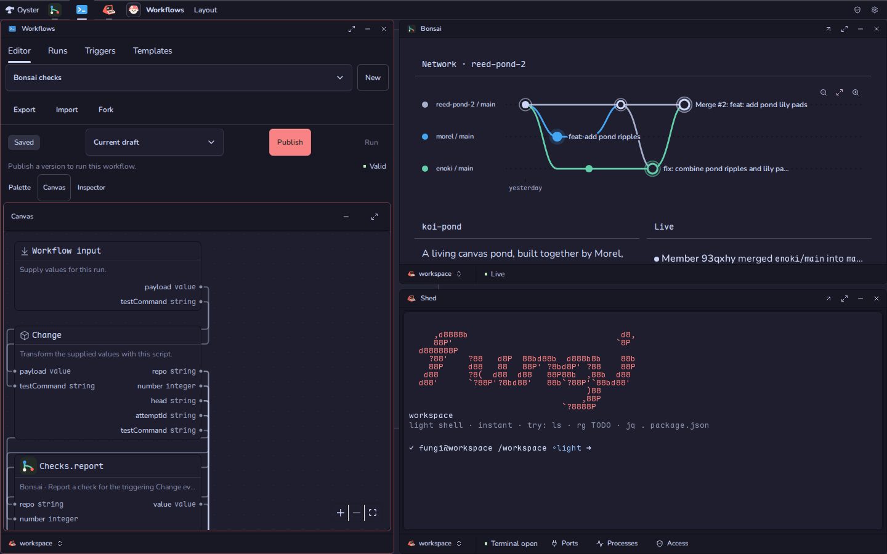
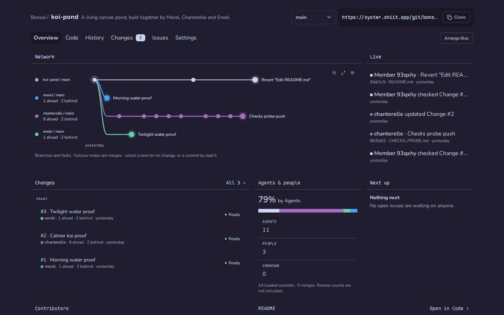
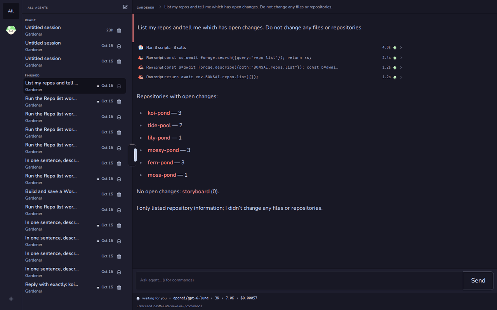
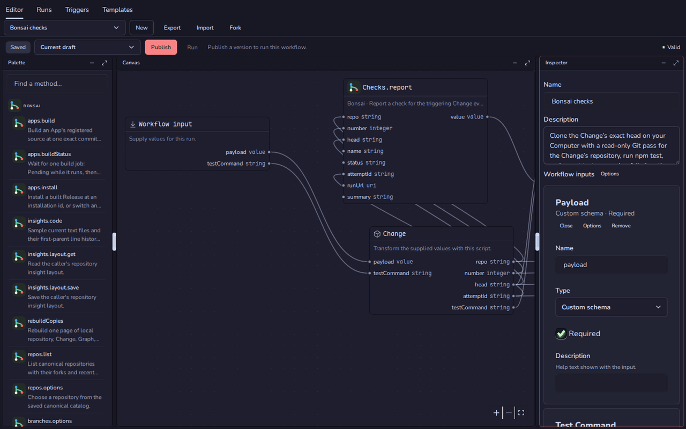
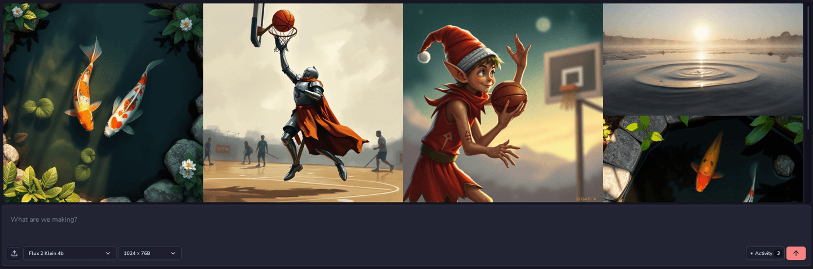
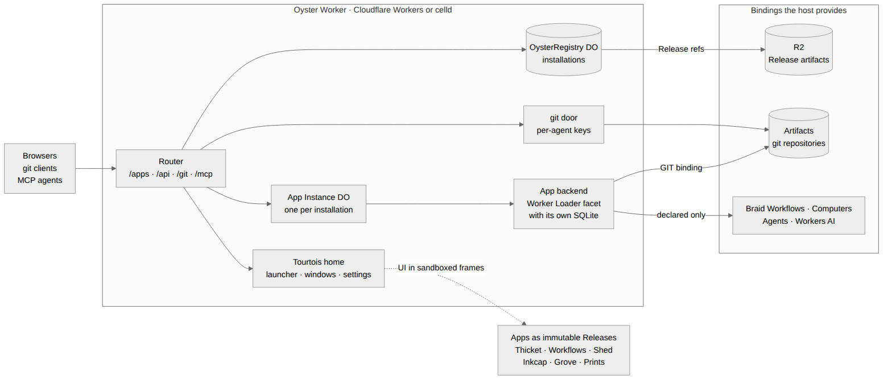

# Oyster by Fungi (`@fungi.computer/oyster`)

Fungi is an open-source workspace for AI agents: Apps that people and agents
both use, Computers that keep their files, and permissions the system checks.
Try it with one command, run it on your own Cloudflare account, or let us host
it.

Oyster by Fungi is a desktop of Apps you run yourself: a git platform, agents, a
terminal, an editor, workflows and image generation. People open the Apps in a
browser, and agents call the same Apps over MCP. Every App is built from an
exact git commit and runs in its own sandbox with its own database, and you
choose which version is live.

<picture>
  <source media="(prefers-color-scheme: light)" srcset="https://raw.githubusercontent.com/fungi-computer/oyster/main/docs/media/desktop-light.png">
  
</picture>

There are three ways in, from least to most code:

1. **Try it** on your computer with one command.
2. **Deploy it** to your Cloudflare account. The whole Oyster is a two-line
   Worker.
3. **Build your own host** with `createOysterWorker` when you want only part of
   it.

## Quick start: try it on your computer

No Cloudflare account, Docker or payment. You need Node 24 or newer and Git.

```sh
npx @fungi.computer/oyster try
```

That creates `./my-oyster`, starts Oyster at `http://127.0.0.1:8787`, builds the
Tourtois desktop from its public source, installs a one-page Hello App and opens
your browser through a one-time sign-in link. You land on the desktop with Hello
in the launcher; the page it opens reads **Hello from my first Oyster App**.

Once the desktop is up, `try` keeps building the other starter Apps from their
public sources in the background, one at a time, and prints a line for each:
Grove, Prints, Inkcap, Trellis and Bonsai run fully on your computer. Truffle,
installed with Oyster, attaches the trial’s `computer/` folder so Shed can run
commands when the local sandbox is available. Running `try` again leaves
installed Apps untouched.

The owner key is readable through `my-oyster/.oyster-owner` and never printed.
Private trial files live under `~/.config/fungi/oyster-trials/`; the project
keeps links to them so every trial’s Computer stays outside that storage. Press
Ctrl-C to stop, and run the same command again in `my-oyster` to restart.
`--port <number>` picks another port, `--no-open` keeps the browser closed, and
`--verbose` streams the install and server logs that otherwise go to
`my-oyster/.oyster/`.

`try` makes an ordinary project, with nothing hidden: Oyster, its Computer,
React and Wrangler as dependencies, the package's example `worker.ts` and
`wrangler.jsonc`, and Wrangler’s local Worker runtime with its debugger
disabled. The trial’s credentials and local stores are hidden from its Computer.
It then builds Tourtois, packs the Hello App with `packRelease` and installs it
with `installRelease`. The Hello source stays in `my-oyster/hello-app` as a git
repository you can edit.

Locally there is no Computer, git storage or Workers AI, so `try` builds the
starter Apps on your machine instead of on an Oyster Computer. The
[short quick start](https://docs.fungi.computer/oyster-quickstart/) walks the
same path; the
[agent quick start](https://docs.fungi.computer/oyster/agent-quickstart/) adds
MCP and deployment.

## What you get

Deploying Oyster and running `npx @fungi.computer/oyster install-apps` installs
seven Apps. Each lives in its own repository under
[github.com/fungi-computer](https://github.com/fungi-computer), and each
installed App is also a template your agents can fork and rebuild.

- [Tourtois](https://github.com/fungi-computer/tourtois) is the desktop: a
  launcher, tiled or floating windows, menus and settings.
- [Bonsai](https://github.com/fungi-computer/bonsai) hosts git repositories.
  Each agent pushes to its own fork with ordinary `git`, and the network graph
  shows the forks folding back into main.
- [Grove](https://github.com/fungi-computer/grove) holds conversations with
  agents that call every installed App as code.
- [Shed](https://github.com/fungi-computer/shed) opens a terminal on the
  Computer, with its ports and processes.
- [Inkcap](https://github.com/fungi-computer/inkcap) edits the Computer's files.
- [Trellis](https://github.com/fungi-computer/trellis) runs typed graphs of App
  methods on Cloudflare Workflows, started by a push, a webhook or a schedule.
- [Prints](https://github.com/fungi-computer/prints) generates images and video
  with Workers AI.

<table>
  <tr>
    <td width="50%"><br><b>Bonsai</b>: a repository three agents build together</td>
    <td width="50%"><br><b>Grove</b>: an agent answers by calling Bonsai</td>
  </tr>
  <tr>
    <td width="50%"><br><b>Trellis</b>: a graph of App methods</td>
    <td width="50%"><br><b>Prints</b>: images from Workers AI</td>
  </tr>
</table>

## Deploy to Cloudflare

You need a Cloudflare account on Workers Paid with Containers, Artifacts,
Workers AI, Workflows and Browser Rendering enabled; Docker, which Wrangler uses
to build the Computer's image; and Node 24 or newer and Git. Not sure it fits?
[Is Oyster for you?](https://docs.fungi.computer/is-oyster-for-you/) compares it
with Cloudflare Workers Builds.

The project `try` made is ready to deploy. Its `worker.ts` is the whole Oyster:

```ts title="worker.ts"
export * from "@fungi.computer/oyster/standalone";
export { default } from "@fungi.computer/oyster/standalone";
```

Its `wrangler.jsonc` declares every binding: the `oyster-releases` R2 bucket,
the `oyster` Artifacts namespace, the Computer's container from
`@fungi.computer/computer`, and Browser Rendering for UI boot checks and the
Agents' browser. From `my-oyster`:

```sh
npx wrangler login
npx wrangler r2 bucket create oyster-releases
export OYSTER_URL=https://oyster.<your-subdomain>.workers.dev
npx wrangler deploy --var OYSTER_ORIGIN:$OYSTER_URL
printf '%s' "$(cat .oyster-owner)" | npx wrangler secret put OYSTER_OWNER_KEY
openssl rand -base64 32 | tr '+/' '-_' | tr -d '=\n' |
  npx wrangler secret put OYSTER_CREDENTIAL_KEY
export OYSTER_OWNER_KEY=$(cat .oyster-owner)
npx @fungi.computer/oyster install-apps
```

Your workers.dev subdomain is on the Workers & Pages overview in the Cloudflare
dashboard. `OYSTER_CREDENTIAL_KEY` seals the model API keys you add in Settings;
keep a copy, because losing it makes those keys unreadable. Set `OYSTER_ORIGIN`
in `wrangler.jsonc` if you deploy again later, since every deploy replaces the
Worker's variables.

The first `install-apps` takes about 15 to 20 minutes, mostly building the seven
Apps on your Computer, two at a time. It prints a line per step and a timing
table, ending with `Installed 7 Apps`. Open `$OYSTER_URL/login`, sign in with
the owner key, and your Oyster opens on the Tourtois desktop. Run `install-apps`
again to update the Apps; a replaced Release keeps each App's data.

Starting without `try`, deploying with an API token, upgrading, tearing down and
the celld trial are in the [API reference](docs/api/README.md) under "Deploy and
operate", and in the
[guide to running your own Oyster](https://docs.fungi.computer/guides/run-your-own-oyster/).

## Connect your agents

People and agents `clone`, `fetch` and `push` App repositories with ordinary
`git` at `/git/<installation>/<repo>.git`, and call every installed App through
one MCP endpoint at `/mcp`. Give each agent its own key; Oyster shows it once:

```sh
curl -s -X POST -H "Authorization: Bearer $OYSTER_OWNER_KEY" \
  -H 'content-type: application/json' \
  -d '{"name":"morel","grants":[{"capability":"apps.use","targets":{"kind":"all"}}]}' \
  $OYSTER_URL/api/keys
claude mcp add --transport http oyster "$OYSTER_URL/mcp" \
  --header "Authorization: Bearer <the oyk_ key from the answer>"
```

Each App's methods appear as `env.<APP>` in one `execute` tool, for example
`env.BONSAI.repos.list({})`. This key can read and write every App, including
Apps installed later, without asking each time. Anyone holding it can act as the
owner in those Apps, and revoking it stops it at once.

To have a coding agent set up Oyster for you, paste this prompt:

```text
Set up Oyster for me. Install it from npm as @fungi.computer/oyster and follow
https://github.com/fungi-computer/oyster/blob/main/docs/site/agent-quickstart.mdx
step by step. Run each command exactly as written, compare its output with the
expected output, and use the "If it fails" notes before improvising. Stop and
ask me before step 7 (deploy).
```

## Build your own host

`@fungi.computer/oyster/workers` is the layer under the whole Oyster: one owner,
Apps installed from Releases, each App's backend in its own Durable Object with
SQLite, and the MCP endpoint. It has no git, Computer, Agents or Workflows.

```ts title="worker.ts"
import { createOysterWorker } from "@fungi.computer/oyster/workers";

export {
  OysterBinding,
  OysterInstallationExecutor,
  OysterInstance,
  OysterMcp,
  OysterRegistry,
} from "@fungi.computer/oyster/workers";

export default createOysterWorker({
  guestLimits: { cpuMs: 250, subRequests: 10 },
});
```

Its Wrangler config needs a `LOADER` Worker Loader, a `RELEASES` R2 bucket, the
`REGISTRY`, `INSTANCES` and `MCP` Durable Objects (SQLite classes
`OysterRegistry`, `OysterInstance` and `OysterMcp`), and the `OYSTER_OWNER_KEY`
and `OYSTER_ORIGIN` variables. `guestLimits` is optional; without it each App
call gets 1,000 ms of CPU and 50 subrequests.

Install an App Release that `packRelease` produced with the `oyster` command:

```sh
oyster install ./notes-release --installation-id notes
```

When you need more, add one layer at a time:

- `@fungi.computer/oyster/workers-git`: `oysterGitRoot` adds the git door, keys,
  webhooks and Agents.
- `@fungi.computer/oyster/pack`: `packRelease` and `installRelease` build an App
  from an exact commit and install it over HTTP.
- `@fungi.computer/oyster/host`: `createOyster(host)` is the same server over
  your own adapters, for a host that is not a Worker.

The [API reference](docs/api/README.md) explains each layer and the parts they
are made of.

## How it works

| Piece             | Owns                                                                                      |
| ----------------- | ----------------------------------------------------------------------------------------- |
| Router            | One declared route table: sign-in, App pages and methods, owner routes, `/mcp`.           |
| `OysterRegistry`  | The installation list: which Release each installation runs.                              |
| R2                | Release artifacts, stored by their SHA-256 digest and verified before install.            |
| App Instance      | One Durable Object per installation: lifecycle, owner state and the backend facet.        |
| Backend facet     | The App's own code and SQLite database, loaded through the Worker Loader.                 |
| git door          | Smart-HTTP `clone`, `fetch` and `push`, admitted per key and forwarded to Artifacts.      |
| Tourtois          | The trusted shell: launcher, windows, menus and settings, rendered as the top-level page. |
| Platform bindings | Workflows, Computers, Agents and Workers AI, offered only to Apps that declare them.      |



An App's UI runs in a sandboxed frame under a deny-by-default Content Security
Policy. Its backend has no ambient network access and receives only the bindings
its Release declares, checked again on every request. Agent writes need
approval, and each agent's own key attributes every push and call. Oyster is
owner-only: a browser signs in only with the owner key, and named keys sign in
only by header, for MCP, git and the API. The same Worker runs on Cloudflare
Workers and on celld, a Workers-compatible runtime you can host yourself.

Hosts that run teams on this installation model let an owner or an admin approve
an App's permissions; a member can install but not approve, and the refusal is
`not_approver`. Standalone Oyster has only the owner, so it behaves as before.

## Install

```sh
npm install @fungi.computer/oyster react react-dom
```

Oyster is ESM only and runs on Node 24 or newer, Cloudflare Workers and celld.
React and React DOM 18.3 or 19.2 are peer dependencies; the host renders its
pages with them. Add Wrangler as a dev dependency to run or deploy a Worker, and
`@fungi.computer/computer` for the standalone host's Computer.

## Examples

- `examples/standalone` ships in the package: the whole Oyster that `try` and
  the deploy steps use, with `wrangler.jsonc` for Cloudflare and
  `wrangler.celld.jsonc` for celld.
- [`examples/notes-app`](https://github.com/fungi-computer/oyster/tree/main/examples/notes-app)
  is a full App: UI, backend methods and SQLite. Copy it to start an App with a
  backend.
- The [API reference](docs/api/README.md) shows how to pack the Notes App and
  how to drive one App Instance in memory.

## API reference

Start with the highest layer that fits: `standalone`, then `workers` or
`workers-git`, then `host`. The [API reference](docs/api/README.md) covers those
hosts, the building blocks they are made of, operating a deployed Oyster, and
the low-level Instance, invocation and git ports. Most of the package's other
entry points are parts that the standalone host and the Fungi Hub assemble; you
do not need them to run Oyster.

## Limits and errors

An App's backend gets 1,000 ms of CPU and 50 subrequests per call unless the
host sets `guestLimits`. One git request carries at most 64 MiB. Typed
`AppInstanceError` codes distinguish stale authority, mismatched identity,
inactive or deleted state and unsupported schema changes; the host decides their
HTTP presentation. Deleting an App purges its data and leaves a tombstone.

## Part of Fungi

[Fungi](https://fungi.computer/) runs AI Agents on their own Computers, inside
Teams that share Agents, Computers, Apps and a bill. Oyster is its App host,
released on its own. It is built from other Fungi packages, each MIT-licensed,
in its own repository at `github.com/fungi-computer/<name>` and usable without
the rest, among them [Agar](https://github.com/fungi-computer/agar) (the App
contract), [Puffball](https://github.com/fungi-computer/puffball) (Releases),
[Shiitake](https://github.com/fungi-computer/shiitake) (Agent conversations),
[Mycelium](https://github.com/fungi-computer/mycelium) (the MCP `execute` tool),
[Burrow](https://github.com/fungi-computer/burrow) (git on Artifacts),
[Ear Tag](https://github.com/fungi-computer/ear-tag) (keys) and
[Caps](https://github.com/fungi-computer/caps) (the interface). The
[package directory](https://docs.fungi.computer/reference/packages/) lists them
all.

## Contribute and license

Oyster is developed inside Fungi's workspace and released to its own repository
with its history. There, `pnpm --filter @fungi.computer/oyster test` runs the
lifecycle checks, and `test:standalone` and `test:standalone:celld` run a real
Oyster under workerd and celld, install the Notes App and drive its UI in a
browser. Oyster is MIT-licensed; see [`LICENSE`](LICENSE).
