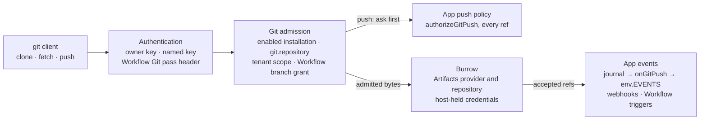

# Oyster (`@fungi.computer/oyster`)

Oyster puts a desktop of Apps on your own Cloudflare account: a git platform,
agents, a terminal, an editor, workflows and image generation, each built from a
git commit on your own Computer.

<picture>
  <source media="(prefers-color-scheme: light)" srcset="https://raw.githubusercontent.com/fungi-computer/oyster/main/docs/media/desktop-light.png">
  
</picture>

Deploy one Worker, run `npx oyster install-apps`, and your Oyster builds seven
Apps on its own Computer and opens on the Tourtois desktop. A live Oyster runs
at <https://oyster.shiit.app/>, and
[CONTEST.md](https://github.com/fungi-computer/oyster/blob/main/CONTEST.md) is
the five-minute tour of it.

## What you get

`oyster install-apps` installs these Apps. Each one lives in its own repository
under [github.com/fungi-computer](https://github.com/fungi-computer), and each
installed App is also a template your agents can fork and rebuild on the same
Computer.

- [Tourtois](https://github.com/fungi-computer/tourtois) is the desktop: a
  launcher, tiled or floating windows, menus and settings.
- [Bonsai](https://github.com/fungi-computer/bonsai) hosts git repositories on
  Cloudflare Artifacts. Each agent pushes to its own fork with ordinary `git`,
  and the network graph shows the forks folding back into main.
- [Grove](https://github.com/fungi-computer/grove) holds conversations with
  agents that call every installed App as code.
- [Shed](https://github.com/fungi-computer/shed) opens a terminal on the
  Computer, with its ports and processes.
- [Inkcap](https://github.com/fungi-computer/inkcap) edits the Computer's files.
- [Trellis](https://github.com/fungi-computer/trellis) runs typed graphs of App
  methods on Cloudflare Workflows, started by a push, a webhook or a schedule.
- [Prints](https://github.com/fungi-computer/prints) generates images and video
  with Workers AI.

<table>
  <tr>
    <td width="50%"><br><b>Bonsai</b>: a repository three agents build together</td>
    <td width="50%"><br><b>Grove</b>: an agent answers by calling Bonsai</td>
  </tr>
  <tr>
    <td width="50%"><br><b>Trellis</b>: a graph of App methods</td>
    <td width="50%"><br><b>Inkcap</b>: the Computer's files</td>
  </tr>
  <tr>
    <td width="50%"><br><b>Tourtois</b>: the inbox and the launcher</td>
    <td width="50%"><br><b>Prints</b>: images from Workers AI</td>
  </tr>
</table>

Shed is in the desktop picture at the top. Oyster itself is the host underneath:
git through Cloudflare Artifacts, a Computer (a Linux workspace in a Cloudflare
Container) that builds Apps and runs their terminals and files, Agents on
Workers AI, Workflows and media.

## Quick start: deploy your own Oyster

You need:

- a Cloudflare account on Workers Paid, with Containers, Artifacts, Workers AI
  and Workflows enabled;
- Docker, which Wrangler uses to build the Computer's container image;
- Node 24, pnpm (npm works the same way) and Git.

The first install takes about 15 to 20 minutes, most of it the seven App builds
on the Computer, one after another. Start a project, add Oyster, its Computer
and Wrangler, and copy the example Worker out of the package:

```sh
mkdir my-oyster && cd my-oyster
pnpm add @fungi.computer/oyster @fungi.computer/computer
pnpm add -D wrangler
cp node_modules/@fungi.computer/oyster/examples/standalone/{worker.ts,wrangler.jsonc} .
```

pnpm 11 may end an `add` with `ERR_PNPM_IGNORED_BUILDS` for packages such as
`esbuild` or `workerd`; they are installed, and Oyster needs none of their
install scripts.

`worker.ts` re-exports the whole host:

```ts title="worker.ts"
export * from "@fungi.computer/oyster/standalone";
export { default } from "@fungi.computer/oyster/standalone";
```

`wrangler.jsonc` names the Worker `oyster`, its Release bucket `oyster-releases`
and its Artifacts namespace `oyster`, and runs the Computer from
`node_modules/@fungi.computer/computer/Dockerfile`. Create the bucket and
deploy. Your Worker's address is `https://oyster.<your-subdomain>.workers.dev`;
your workers.dev subdomain is on the Workers & Pages overview in the Cloudflare
dashboard.

```sh
npx wrangler login
npx wrangler r2 bucket create oyster-releases
export OYSTER_URL=https://oyster.<your-subdomain>.workers.dev
npx wrangler deploy --var OYSTER_ORIGIN:$OYSTER_URL
```

Set `OYSTER_ORIGIN` in `wrangler.jsonc` instead if you deploy again later; every
deploy replaces the Worker's variables.

Choose an owner key and store it as a secret:

```sh
export OYSTER_OWNER_KEY=$(openssl rand -hex 24)
printf '%s' "$OYSTER_OWNER_KEY" | npx wrangler secret put OYSTER_OWNER_KEY
```

### Install the starter Apps

```sh
npx oyster install-apps
```

The installer clones each App's repository, seeds it on your Oyster with
`git push`, and builds the Apps on your Computer, Tourtois first, installing
each as its build succeeds. It prints a line per step and then where the time
went:

```
tourtois source recorded at git:…
…
Building tourtois on the Computer (build_…)
Installed tourtois from its build build_…
Building bonsai on the Computer (build_…)
…
Installed grove from its build build_…

App	fetch	seed	queue	build	clone	deps	compile	upload	install
tourtois	…
…
Installed 7 Apps in …. Open https://oyster.<your-subdomain>.workers.dev/ to use Tourtois and the installed Apps.
```

Open `$OYSTER_URL/login` and sign in with the owner key: your Oyster opens on
the Tourtois desktop with all seven Apps, as in the pictures above.

Run `install-apps` again to update them; a replaced Release keeps each App's
data. `--ref` picks a branch or tag of the App repositories, `--repositories`
another host for them, and `--timings <file>` writes the timing table as JSON.
Builds run two at a time on the example's `standard-4` Computer (12 GiB).
`--concurrency 1` runs them one at a time and `--concurrency 3` three at once.

### Git, keys and MCP

People and agents `clone`, `fetch` and `push` App repositories with ordinary
`git` at `/git/<installation>/<repo>.git`. Give each agent its own key; Oyster
shows each key once:

```sh
curl -s -X POST -H "Authorization: Bearer $OYSTER_OWNER_KEY" \
  -H 'content-type: application/json' \
  -d '{"name":"morel","grants":[{"capability":"apps.use","targets":{"kind":"all"}}]}' \
  $OYSTER_URL/api/keys
```

The answer's `plaintext` field, starting `oyk_`, signs in to `git` and to
`/mcp`. That key can read and write every App on this Oyster, including Apps
installed later, without asking each time; anyone holding it can act as the
owner in those Apps, and revoking it stops it immediately.

Any MCP client can call every installed App with a key. For Claude Code:

```sh
claude mcp add --transport http oyster "$OYSTER_URL/mcp" \
  --header "Authorization: Bearer <the agent's key>"
```

### What the live demo runs

<https://oyster.shiit.app/> runs this same host with the same seven Apps. Its
`koi-pond` repository is a small canvas game three coding agents built together,
each in its own fork with its own key, with Bonsai drawing a lane per agent as
they pushed and merged.
[CONTEST.md](https://github.com/fungi-computer/oyster/blob/main/CONTEST.md)
tours it.

## Part of Fungi

[Fungi](https://fungi.computer/) runs AI Agents on their own Computers, inside
Teams that share Agents, Computers, Apps and a bill. Oyster is its App host,
released on its own, and it is built from 21 more Fungi packages released with
it. Each one is MIT-licensed, has its own repository at
`github.com/fungi-computer/<name>`, installs from npm as
`@fungi.computer/<name>`, and works without the rest. Installing Oyster brings
in the ones it runs on.

Apps and hosting:

- [Agar](https://github.com/fungi-computer/agar): the App contract. Typed
  backend methods, host capabilities and the connection between an App's
  frontend and its host.
- [Puffball](https://github.com/fungi-computer/puffball): a catalog of web Apps
  and their immutable Releases, which serves only promoted Releases and checks
  every artifact against its recorded digest.
- [Gills](https://github.com/fungi-computer/gills): compact plain-text App views
  shared by browser and terminal hosts.
- [Whistle](https://github.com/fungi-computer/whistle): one command definition
  becomes key bindings, a command palette, slash commands, help, a menu and an
  agent tool, all running through one typed `execute` door.

Agents and tools:

- [Shiitake](https://github.com/fungi-computer/shiitake): durable Agent
  conversations. A Session holds accepted work, messages and observations; the
  host supplies storage, models and tools.
- [Mule](https://github.com/fungi-computer/mule): runs Pi's model and tool loop
  inside Effect as an awaited, cancellable run.
- [Mycelium](https://github.com/fungi-computer/mycelium): gives an Agent typed
  operations through one `execute` tool, with a capability snapshot acquired and
  released per run.
- [Knapsack](https://github.com/fungi-computer/knapsack): connects an Agent to
  Computers, files and remote MCP servers as Mycelium capability sources.
- [Forage](https://github.com/fungi-computer/forage): lists, searches and
  describes a catalog of operations, so a caller or a model finds the right one.
- [BirdDog](https://github.com/fungi-computer/bird-dog): durable mail between
  agent sessions, with replies retried from an outbox until they are accepted.

Durable work, git and keys:

- [Watchdog](https://github.com/fungi-computer/watchdog): a small durable job
  engine on SQLite, D1 or PostgreSQL. Each job settles with exactly one recorded
  outcome, even across restarts.
- [Carrier](https://github.com/fungi-computer/carrier): durable email delivery
  whose receipts record only what the provider said, and ordered envelopes
  between Durable Objects.
- [Burrow](https://github.com/fungi-computer/burrow): the repository owner for
  Cloudflare Artifacts, serving only Git's smart-HTTP operations and never
  returning a credential.
- [Ear Tag](https://github.com/fungi-computer/ear-tag): bearer keys and their
  hashes, a typed grant vocabulary, and a tenant-scoped key store with
  revocation, expiry and a per-key rate limit.
- [Cairn](https://github.com/fungi-computer/cairn): typed, opaque identifiers,
  temporary keys and candidate word names, with their parsers.

Interface:

- [Stipe](https://github.com/fungi-computer/stipe): a CSS-first theme layer for
  Tailwind CSS v4 and daisyUI 5, with spacing, fonts and material tokens.
- [Caps](https://github.com/fungi-computer/caps): accessible React primitives
  and blocks, from buttons and dialogs to a chat composer and window frames,
  themed by Stipe.
- [Maosaico](https://github.com/fungi-computer/maosaico): arranges React panes
  inside a measured container, with floating frames and optional tiling.
- [Sigils](https://github.com/fungi-computer/sigils): Fungi's decorative SVG
  marks and their gallery.
- [Sprite](https://github.com/fungi-computer/sprite): shows an animated
  character through a renderer the host installs.
- [Sprite Zdog](https://github.com/fungi-computer/sprite-zdog): a Canvas
  renderer for Zdog characters, with built-in characters and authoring tools for
  Sprite.

## Hand this to your agent

Paste this prompt into a coding agent (Claude Code, Codex or any other) to have
it set up a local Oyster, install an App, connect over MCP and deploy:

```text
Set up Oyster for me. Install it from npm as @fungi.computer/oyster and follow
https://github.com/fungi-computer/oyster/blob/main/docs/site/agent-quickstart.mdx
step by step. Run each command exactly as written, compare its output with the
expected output, and use the "If it fails" notes before improvising. Stop and
ask me before step 7 (deploy).
```

The guide ships in the package as `docs/site/agent-quickstart.mdx`. It needs
Node 24, pnpm and Git; a Cloudflare account matters only for the deploy step.

## Why Oyster

**Apps are Releases with provenance.** `packRelease` builds an App from one
commit and records it as `sourceRevision: git:<sha>`. Every artifact is
addressed by its SHA-256 digest, and Oyster verifies each digest before it
installs or replaces a Release. Replacing a Release keeps the App's data;
deleting it purges the data and leaves a tombstone.

**Every App is isolated.** An App's backend loads through a Worker Loader into
its own Durable Object facet with its own SQLite database. It has no ambient
network access. It receives only the bindings its Release declares (`GIT`,
`EVENTS`, Computer, agent, workflow, media), and Oyster checks that declaration
again on every request. App pages are served with a deny-by-default Content
Security Policy inside a sandboxed frame.

**Git is a binding.** An App that declares `git.repository` gets `env.GIT`:
create, fork, log, read and merge on Cloudflare Artifacts, scoped to its
installation. People and agents push with ordinary `git` through Oyster's git
door using their own keys; the host keeps every provider credential. Each
accepted push reaches the App's `onGitPush` handler and can start a Workflow or
a signed webhook.

**Agents are first-class callers.** `POST /mcp` serves one MCP endpoint for the
whole Oyster. Every installed App's methods appear as typed `env.<APP>` modules
that an agent discovers and calls from code; a dotted method is a nested
property, e.g. `env.BONSAI.repos.list({})`. Writes need explicit approval. Each
agent has its own key, so every push and call is attributed.

**Workflows compose Apps.** Trellis stores each graph in git, so a commit is a
version. Each graph compiles to a plan with a digest and runs on Cloudflare
Workflows. Steps call App methods and can run a sandboxed Code node or a step in
a Computer.

**Computers are ordinary capabilities.** A Computer is a durable workspace with
a Container backing. Shed opens its terminal, Inkcap edits its files and port
previews serve what it runs on signed hostnames. Apps reach it only through the
`computer.*` capability they declare.

**The desktop is a trusted shell.** Tourtois is installed like any other
Release, but your Oyster renders its home installation as the top-level page,
with every permission you have as owner. Each App it opens still runs in its own
sandboxed frame inside that App's window. Pick a shell you trust: it can do
anything you can.

## Architecture

An Oyster is one Worker. Every App installed on it is an immutable Release built
from an exact git commit. Its UI runs in a sandboxed frame, its backend runs in
its own Durable Object with its own SQLite, and it receives only the bindings it
declares. Agents reach every installed App through one MCP endpoint. The same
Worker runs on Cloudflare Workers and on celld, a Workers-compatible runtime you
can host yourself.


| Piece             | Owns                                                                                      |
| ----------------- | ----------------------------------------------------------------------------------------- |
| Router            | Sign-in, `/apps/<installation>/` pages, App methods, owner `/api/*` routes and `/mcp`.    |
| `OysterRegistry`  | The installation list: which Release each installation runs, and its visibility.          |
| R2                | Release artifacts, stored by digest.                                                      |
| App Instance      | One Durable Object per installation: lifecycle, owner state and the backend facet.        |
| Backend facet     | The App's own code and SQLite database, loaded through the Worker Loader.                 |
| git door          | Smart-HTTP `clone`, `fetch` and `push`, admitted per key and forwarded to Artifacts.      |
| Tourtois          | The trusted shell: launcher, windows, menus and settings, rendered as the top-level page. |
| Platform bindings | Workflows, Computers, Agents and Workers AI, offered only to Apps that declare them.      |

The diagram source is
[`docs/media/architecture.mmd`](https://github.com/fungi-computer/oyster/blob/main/docs/media/architecture.mmd).

## Install or set up

```sh
pnpm add @fungi.computer/oyster
```

Oyster is ESM only and runs on Node 24 or newer, Cloudflare Workers and celld.
React and React DOM 18.3 or 19.2 are peer dependencies; the host renders its
pages with them. Wrangler is an optional peer dependency: add it as a dev
dependency to run or deploy the example Workers, which ship in the package under
`examples/`. The generated [API reference](docs/api/README.md) ships in the
package too.

Oyster's runtime dependencies are other Fungi packages, among them
[Agar](https://github.com/fungi-computer/agar) for the App contract,
[Puffball](https://github.com/fungi-computer/puffball) for Releases and
[Mycelium](https://github.com/fungi-computer/mycelium) for the MCP `execute`
door. "Part of Fungi" above lists them all.

## Run your own Oyster

`@fungi.computer/oyster/standalone` is the whole host the quick start deploys:
the git root below plus tenancy, a Computer (`ComputerDO`, a Cloudflare
Container or an on-box VM), Agents on Workers AI composed from stock
[Shiitake](https://github.com/fungi-computer/shiitake) Durable Objects,
Workflows, media, and the owner routes that seed App templates and build them on
the Computer. `examples/standalone/wrangler.jsonc` declares every binding it
uses. Set the owner key as a secret (`OYSTER_OWNER_KEY`, 24+ characters) and
deploy with `wrangler deploy`. Sign in at `/login`.

The layers it is built from stay exported for hosts that compose their own:
`@fungi.computer/oyster/workers` (Releases, Instances, MCP and App storage) and
`@fungi.computer/oyster/workers-git` (the git door), with `oysterAppMethods`
supplying the installed App catalog to an Agent runtime.

Pack and install an App with `@fungi.computer/oyster/pack`: `packRelease` turns
an exact Git commit and a canonical build recipe into a Release with immutable
artifacts, and `installRelease` uploads it. Each installed App gets:

- its UI at `/apps/<installation>/`, in a sandboxed frame connected through
  Agar's `app.backend` capability;
- its methods at `POST /apps/<installation>/methods/<name>` (JSON in and out);
- its own SQLite state in its Instance's `app` facet.

`createOyster(host)` from `@fungi.computer/oyster/host` is the same server over
your own adapters (`auth`, `artifacts`, `installations`, `instances`, `mcp`,
`capabilities`).

### Add Git to your host

Git is one optional field of the typed host: `host.git`. When it is present,
`createOyster` mounts the git door at `/git/<installation>/<repo>.git`, and
people and agents `clone`, `fetch` and `push` with ordinary git. Nothing else in
the host changes.

There are two ways to get it:

- **Use one Git root.** `oysterGitRoot(options)` from
  `@fungi.computer/oyster/workers-git` is the whole composition: the git door
  plus tenancy, Agents and their owner-only approval routes, workspace and
  capability slots, the page script and the home App. Its `hostFor(env, scope)`
  is the only way a tenant host is built. Pass the root to
  `createOysterGitWorker` for HTTP and to `createOysterGitMcpOwner` for MCP, and
  return `root.hostFor(this.env, scope)` from your `OysterGitInstance` subclass,
  so HTTP, MCP and background wakes share one composition. `tenancy` is
  required; a single-owner root passes `ownerOrKeyTenancy`, so the owner key and
  named keys sign git in. `@fungi.computer/oyster/standalone` is a real
  multi-door caller. Its `wrangler.jsonc` adds the `ARTIFACTS` binding and the
  `KEYS` and `WEBHOOKS` Durable Objects.
- **Set `host.git` on your own host.** Keep your own `createOyster(host)`
  composition and set `git: oysterWorkerGit(env, { scope })` and
  `ownerRoutes: gitAdminRoutes(env, scope)` for `/api/keys` and `/api/webhooks`,
  with the tenant `scope` your host selected.

The git root, from Workers:

```ts title="worker.ts"
import type { TenantScope } from "@fungi.computer/oyster/tenant";
import {
  createOysterGitMcpOwner,
  createOysterGitWorker,
  OysterGitInstance,
  oysterGitRoot,
  ownerOrKeyTenancy,
  type OysterGitWorkerEnv,
} from "@fungi.computer/oyster/workers-git";

const root = oysterGitRoot<OysterGitWorkerEnv>({ tenancy: ownerOrKeyTenancy });

export class OysterMcp extends createOysterGitMcpOwner(root) {}

export class OysterInstance extends OysterGitInstance {
  protected hostFor(scope: TenantScope) {
    return root.hostFor(this.env, scope);
  }
}

export default createOysterGitWorker(root);
```

A host also exports the Durable Objects and the git `OysterBinding` entrypoint,
whose table also serves `env.GIT` and `env.EVENTS`. The package's
`test:git-door` check runs that root (`test/git-root.fixture.ts`) on workerd
against real bare repositories: the owner pushes with `git`, a named agent key's
push is refused by the App's policy with Git's own `ng` report, both keys clone,
and the accepted push reaches the App's `onGitPush`.

Each layer owns one decision:



- **Authentication** is the host's own `auth`. The owner key is a Bearer token;
  a named key may also be the Basic password from a git credential helper. A
  Workflow Git pass (a `wgp.` Bearer header, never in a URL) goes only to
  `host.git.workflowPass`; without that port it admits nothing. Anonymous
  requests read only public installations and never push.
- **Git admission** reopens the live installation before every provider call: it
  must be enabled and its Release must declare `git.repository`. The tenant
  scope prefixes every repository name (`<installation>--<repo>` for the default
  tenant), so an installation reaches only its own repositories. A Workflow
  writer may push only the branches its grant names.
- **The App's push policy** answers `authorizeGitPush` for every ref update
  before any bytes reach the provider. One refusal rejects the whole push with
  Git's native `ng` report. Unsupported receive-pack commands, including signed
  push certificates, fail closed.
- **Burrow** owns the provider and the repository. The host's Artifacts adapter
  mints short-lived credentials through it and forwards the admitted smart-HTTP
  exchange (up to 64 MiB per request); the App sees repository names, git
  objects and its own events, never a credential or remote.
- **App events** start from the accepted-ref journal. Delivery calls the
  selected Instance's `onGitPush` when the Release declares
  `receives: ["git.push"]` and `git.repository`. The App emits typed events
  through `env.EVENTS`: Oyster delivers them as signed Standard Webhooks, and a
  host with Cloudflare Workflows (the Hub, or the live demo's root) starts the
  Workflow triggers armed on that event.

Agent approval stays owner-direct in both compositions: the approval routes are
owner routes, refuse App-origin requests, and are never an `OysterCapability` an
App can be granted.

#### Git bindings, journal and lower-level ports

A Release's `backend.bindings` determines whether its App gets `env.GIT`
(Cloudflare Artifacts, scoped to its installation; credentials stay in the host)
or `env.EVENTS` (delivered as Standard Webhooks to subscriptions the owner
creates at `/api/webhooks`). Each binding enforces its declared operations.
`await env.GIT.cloneUrl(repo)` returns the host-issued clone URL; an undeclared
binding grants nothing. Declaration changes invalidate the loader entry even
when the backend bytes stay the same. Agents push with keys from `/api/keys`.

Hosts compose one `createAdmittedGit` with an installation-scoped store, live
host grants, the App's typed `authorizeGitPush` policy and an accepted-ref
journal. `GitWriter`, `GitPushQuestion`, `GitPushVerdict` and accepted facts
come from `@fungi.computer/agar/git`; the shared wire parser is in
`agar/git-wire`.

An App's own `GIT` binding uses `admitted.binding(onBehalfOf)`. Its writer is
`installation`, with the host-attested caller retained in `onBehalfOf`. These
writes skip the App's external-push policy, retain live host admission and enter
the same accepted-ref journal. The journal records only refs accepted by the
provider and commits before the exchange is acknowledged. Redelivery keeps the
complete original fact and `eventId`; handlers record that ID with their
effects.

`createGitPushJournal` composes the standalone Instance's SQLite owner with
Carrier delivery and an alarm hook. Its accepted fact, ref tips and Carrier send
commit together; Carrier retains delivery attempts across restarts and retries.
The Hub composes its ref journal and `TeamPost.sendGitPush` in one host
transaction. Neither HTTP routing nor the provider adapter creates a second push
fact.

`createGitDoor` from `@fungi.computer/oyster/git` accepts the host's
`authenticate`, `isPublic` and `git` ports. `authenticate` receives the request
and the exact installation, repository and read/write scope it names. The last
returns an `AdmittedGit`; the door forwards reads to `.read` and pushes to
`.push`. Provider credentials stay inside the storage adapter. `createOyster`
builds these ports from `host.auth`, `host.installations` and `host.git`, so
most hosts set `host.git` and never call `createGitDoor` directly.

A host that mints Workflow Git passes supplies `workflowGitPass` in
`oysterGitRoot` or `oysterWorkerGit` options. A pass travels only as an
`Authorization: Bearer` header starting with `workflowGitPassPrefix` (`wgp.`) on
the ordinary credential-free door URL; it is never part of a URL. That header is
admitted only by the port, for one repository and scope, as the arming member
under the Workflow's branch grant, and never as a session or key. Pushes outside
those branches are refused before the App's push policy runs.

### Provide App capabilities

Each `OysterCapability` supplies its Agar `id` and `version`, a mount `base`,
relative Hono `routes`, an `admits(principal, installation)` decision, and
`methods`. Each method descriptor has `kind`, `method` (HTTP method), and `path`
(relative route). `CapabilityMethodKind` is `json | transport | read | write`:
JSON calls return decoded data, transports return Fetch handles, and
reads/writes return Agar's stream handles.

Method paths may contain named parameters, such as `:agentId/sessions`. Oyster
uses `path-to-regexp` to compile input fields into those parameters; remaining
scalar fields become query parameters for GET and handle calls. Other JSON calls
keep their remaining fields in the request body. Transport handles append their
Fetch pathname below that resolved route and may declare `method: "ANY"` to
retain the request's HTTP method. JSON results, including Agar's
`{ kind: "pending", retryAfterMs }`, reach the App unchanged; the page does not
poll on the App's behalf.

For example, a directory method uses
`{ kind: "json", method: "GET", path: "list" }`; a file read uses
`{ kind: "read", method: "GET", path: "content" }`. `fileCapabilities(source)`
from `@fungi.computer/oyster/files` supplies the three file contracts over the
existing `/files/` GET, PUT and POST routes.

The page offers a capability only when the installed Release declares its ID and
`admits` allows the principal. Visitors receive none. Every route request also
rechecks that declaration and admission using the `X-Oyster-Installation` header
set by the page; a read grant does not authorize the write route sharing its
file mount.

Consent approves capabilities, like OAuth scopes. An App upgrade may add a
method that uses an already-approved capability without asking again. A new
capability always needs approval. Release selection intersects stored operation
and resource approvals; it never adds a grant. Every Worker call receives only
the bindings allowed by that method's declared `requires`, rather than all the
App's approved capabilities.

The `agent.manage` consent wording is **Can create Agents; write abilities need
your approval.**

The `apps.call` permission also shows the declared target Apps and methods. Its
route approvals retain those exact pairs: adding or renaming a target method
needs owner approval. On Oyster these page calls run as the signed-in member
through the target App's ordinary method gate; Agents, keys and visitors cannot
use this path. The target receives its own grants, never the caller App's
grants. The Hub shows the same consent list but does not offer this page
capability.

### Connect an agent over MCP

Connect your MCP client to `https://<your-oyster>/mcp` with
`Authorization: Bearer <key>`. Installed App methods are available through
`execute` as `env.<APP>`; a dotted method is a nested property, e.g.
`env.BONSAI.repos.list({})`; discover them with `forage.search` and
`forage.describe`. A key's or Agent's App writes run under the owner's stored
approval of its App tools (recorded when the owner creates the key), so a
headless client such as `claude -p` can write. That approval already covers
every App on this Oyster, including ones installed after the key existed, with
no per-call prompt; anyone holding the key can act as the owner in those Apps,
and revoking the key is what stops it. Every other write, including the owner's
own calls, requires a client that supports form elicitation and explicit
approval; anonymous callers are refused.

When the host has a Computer, the catalog also holds it as
`env.computers.workspace`, e.g.
`env.computers.workspace.exec({ command: "ls", cwd: "/workspace" })`. Its
operations are the ones every Computer advertises (`read`, `list`, `write`,
`mkdir`, `bash`, `exec` and the process tools), and each call asks for approval.
The host supplies `computer(principal)` on its workspace: it returns the
Computer's calls for a caller with Computer access and `null` otherwise. The
standalone host gives an owner, key or member the same Computer grant its
`/computer` routes use; visitors and Agents get none. The Computer accepts every
call against that grant. `oysterComputerTools(host, principal)` from
`@fungi.computer/oyster/mcp` returns this Knapsack source and its `grants`.

Workers route every MCP request to the tenant's `MCP` Durable Object. Export
`OysterMcp` from `oyster/workers` for the default host, or derive it from
`createOysterGitMcpOwner(root)` with the same root passed to
`createOysterGitWorker(root)`. Declare the `MCP` binding and SQLite migration as
shown in the standalone example, and configure `OYSTER_ORIGIN`.

The owner authenticates every request. SDK session IDs, event data and closure
belong to that owner; deleting a session releases its catalog connection. If an
owner restarts and cannot restore its live SDK transport, the old ID
returns 404. Close the client's old transport and initialize a fresh session.
Pending execution and elicitation are never replayed. Node hosts retain their
explicit MCP adapter and call its `close()` when shutting down.

Agent and key adapters use `await oysterAppMethods(host, principal, access)`
from `@fungi.computer/oyster/mcp`. Pass the result in Mycelium's `sources`; its
`grants` names each captured module at the level (`read`/`write`) the caller
actually holds for it, so Mycelium itself refuses a write call up front when a
module's own grant is `read`. For an Agent, `access` is
`{kind: "agent", policy}`, the host's one stored, blanket
`{level, revision, grantedBy}` approval; missing it grants no tool access. For a
named key, `access` is `{kind: "key", keyId, byInstallation}`, one
`{level, revision, grantedBy}` per installation the key's own Ear Tag grants
admit (`keyAppAccess`); an installation the key has no grant for is absent from
`byInstallation` and never listed at all, not merely refused. A key's grants are
set once, at `POST /api/keys`, and never edited: to change them the owner
revokes the key (`POST /api/keys/revoke`) and issues a new one. A module grant
does not approve an App operation. The gate also intersects the installation's
explicit approvals with its verified Release; `external` methods are refused
with `approval_required`. MCP uses this same projection. Capture again when tool
policy, installation authority, a key's own grants or a Release changes; the
source represents one immutable catalog snapshot.

### Approve an Agent's App tools

An App with `agent.manage` can create Agents and request tool-policy changes.
The host records the admitted installation; those requests remain pending and
have no `grantedBy`. Only direct owner approval grants App tools. The standalone
owner key resolves through the seeded tenancy registry: `grantedBy` is the
canonical stored member ID, while `OYSTER_OWNER_NAME` is an identity label. The
stored approval pins that member's `membershipVersion`; demotion and
re-promotion, removal and re-addition, or suspension and reactivation require
new approval. Old policy rows also require re-approval.

The authenticated owner reads `GET /api/agent-policies/:agentId` for the current
`expectedRevision`, then sends `PUT` to the same path with
`{"level":"write","expectedRevision":"<the returned revision>"}` (or `null` when
no policy exists). These host-owned routes reject an App installation header.
The Agent must have its host-minted directory/tenant pin; another tenant or an
unpinned Agent refuses. A stale revision returns 409, an unknown Agent returns
404, and malformed approval input returns 400.

### Connect an Agent to a remote MCP server

The owner connects any Streamable HTTP MCP server to one Agent. The Agent's
codemode then sees its tools as `env.mcp.<name>.<tool>()`, beside the installed
Apps; Knapsack's `mcpServers` connection owns the client. On a standalone Oyster
the Agent's own Durable Object keeps the endpoint and an optional bearer token,
and no route returns the token.

`GET /api/agent-mcp-servers` lists every Agent with its servers (`serverId`,
`name`, `url`, `hasBearer`). `POST /api/agent-mcp-servers/:agentId` with
`{"name":"linear","url":"https://mcp.example.com/mcp","bearer":null}` connects
one; the name is lowercase letters, digits and `_`, and the endpoint must be
`https:` with no credentials or fragment. A repeated name or more than 16
servers returns 409. `DELETE /api/agent-mcp-servers/:agentId/:serverId`
disconnects one. These routes are owner-direct and reject an App installation
header. A server that is down or refuses the token is left out of that run and
the others stay available. OAuth sign-in is not offered yet.

### Pack an App

`packRelease` composes `oyster/build`'s source capture, candidate preparer,
compiler and local artifact writer. Pass `sourceDirectory` as the repository
root, an explicit `sourceRevision` (`git:<full commit SHA>`), and `recipe`.
Every entry is relative to that captured repository root. Dirty files and
external build outputs are not inputs. The result retains `release.json` plus
`artifacts/`, ready for `installRelease`. This example packs the
[Notes example App](https://github.com/fungi-computer/oyster/tree/main/examples/notes-app)
kept at the root of its own git repository, `./notes-app`:

```ts
import { execFileSync } from "node:child_process";
import { packRelease } from "@fungi.computer/oyster/pack";

const commit = execFileSync("git", ["-C", "./notes-app", "rev-parse", "HEAD"], {
  encoding: "utf8",
}).trim();

await packRelease({
  appId: "app_notes",
  sourceDirectory: "./notes-app",
  sourceRevision: `git:${commit}`,
  recipe: {
    entry: "ui/index.html",
    assets: {
      maxManifestBytes: 1_048_576,
      maxObjects: 1024,
      maxObjectBytes: 16_777_216,
      maxTotalBytes: 67_108_864,
    },
    assetBase: "./",
    maxOutputBytes: 67_108_864,
    backend: {
      entry: "backend/index.ts",
      exportName: "Notes",
      compatibilityDate: "2026-09-04",
      runtime: { kind: "durable-facet", stateSchema: 1 },
    },
  },
  outDirectory: "./notes-release",
});
```

The canonical compiler reads the nearest package's `fungi.app` declaration,
including capabilities and commands for UI-only Apps. Backend Apps declare
`fungi.backendDefinition`; the emitter derives the API and declaration from that
definition and `fungi.app` in the same build that produces the Worker.
Handwritten package API methods are refused. Closed source HTML recipes
(including Notes, Bonsai and Inkcap) build captured source.
`kind: "bundled-html"` instead accepts committed, ready assets such as
`bundle/index.html`, with an explicit asset policy.

`installFromSource` accepts `appId`, `recipe`,
`source: {remote, token, sourceRevision}` and the destination Oyster's `url`,
`key` and `installationId`. It uses the maintained Artifacts Git capture, the
same build/writer composition, then `installRelease`, and cleans its temporary
output. Source credentials and the destination owner key remain separate.
`installRelease` uploads a packed Release and makes one
`POST /api/installations` naming the installation. The host's one
install-or-select owner installs it (201) or, when the installation already
exists, switches it to that Release (200); the App keeps its state, and every
other refusal is returned unchanged.

## Build a shell

`@fungi.computer/oyster/shell` supplies the client side of hosting Apps. It can
be imported independently of the Workers server and Node packing helpers. The
same exports are available through focused entries:

| Entry                    | Contract                                                                            |
| ------------------------ | ----------------------------------------------------------------------------------- |
| `./shell/workbench`      | Workbench host contract, shared child-window host, Gill layout and arranger shapes. |
| `./shell/command-host`   | A Whistle graph that admits mounted commands against verified Release declarations. |
| `./shell/keys`           | DOM key dispatch and shared chord matching.                                         |
| `./shell/commands`       | Window, App picker and command palette declarations over host callbacks.            |
| `./shell/window-manager` | Window generations, visibility, navigation, cancellation and disposal.              |
| `./shell/app-directory`  | App addresses, reusable directory rows and catalog metadata.                        |

`./shell/shell-module` is the contract between a host and the shell it runs, and
is imported on its own rather than through `./shell`. A shell Release exports
`mountShell(root, input)` (`MountShell`); `input` (`ShellMountInput`) carries
the workbench handle, the shell installation's `AppStorage` and
`methods.call(method, input)` for its declared backend methods, which takes the
input as JSON text and resolves with the decoded JSON result.
`importShellModule(moduleUrl, hostOrigin)` imports the picked shell's module
from the host's own origin, checks that it exports `mountShell`, and rejects
with `ShellModuleError` otherwise. The host never bundles a shell.

Supply your own mount adapter to `createWindowManager`. It receives the
container, launch descriptor, cancellation signal and navigation callbacks; its
returned handle owns visibility, reconfiguration and disposal. The manager
disposes stale mounts and serializes changes to each window. It neither picks
Apps nor grants capabilities.

`createAppSurfaceCommandHost` owns command contribution and focus. Give
`mount(id, declarations)` the verified Release's declarations and pass the
returned handlers to Agar's `connectAppHost`. A mounted App cannot introduce an
undeclared command or claim the reserved shell chord. Dispose its command mount
when its iframe closes, and dispose the command host with the shell.
`installShellKeys` attaches DOM listeners only when called; its return value
removes them. Terminal shells can use the command and window owners without a
DOM.

Directory metadata is not launch authority. A host extends the public row schema
with its own permission model and admits each mount itself. Fungi's Team
directory, Team settings capability and signed Hub/host protocol live in its
private consumers; the public shell imports none of them.

`@fungi.computer/oyster/page` mounts one installed App's page and connects its
sandboxed frame with that installation's admitted slots. That page is only the
framed App: menus, the command palette, status bars and every other piece of
desktop chrome belong to the shell.

### The shell is trusted

A shell is not a framed App. When an owner opens the home installation, the page
is served with an empty `#oyster-shell` root and the host's page script renders
the shell there, in the top-level document. The shell runs with the host's
escalated permissions: it reads the installation directory and opens, arranges
and closes every App. Choose a shell you trust, as you would choose the host
itself.

Child Apps stay isolated. `WorkbenchHost.mount(container, launch, events)`
mounts each App in its own sandboxed, cross-origin frame (`appSandbox`), inside
the `container` slot the shell hands it. The shell keeps one stable slot per
window and moves that window with transforms, so the frame moves, clips to the
window's rounded corners and stacks below shell menus in the same rendered
frame. Slots are never re-parented, and a minimized window keeps its frame
mounted, so restoring it never reloads the App. A click inside a frame never
reaches the shell; the App's own focus report raises its window. Every child
keeps its own configuration and capabilities; nothing granted to the shell is
lent to it. Read the home installation's own handles with
`oysterShellHandles(readOysterPageConfig())`, and connect each child frame with
`connectOysterApp`.

The standalone root chooses its home by installation ID. Oyster core imports no
home App: it serves the selected enabled installation, or its installation list
when no home is available. `@fungi.computer/oyster/root-data` adapts the
existing installation and verified Release owners into shared workbench metadata
and opens the existing SQLite App-storage owner with fresh admission. The
deployable Bonsai root mounts Tourtois's own `PlatformControlsView`, offering
desktop and App settings. Unsupported hosted administration and platform
destinations are not offered; Computer inventory and Gill resource reads
currently refuse.

The workbench host handle offers `memberAvatar()` as a read-only projection of
the signed-in member's catalog-validated avatar preference. Consumers refresh
that read when host settings change. Account writes remain Hub-owned.

## Core concepts

### Owner state and selection

The host calls `apply` with the complete owner-issued state, then `fetch` or
`call` with the admitted selection. Both identify the Instance, owner, App,
Release and authority version. Oyster persists the version the owner supplied;
it never increments another owner's authority or trusts a guest's claim to it.

| Owner state | Runtime behavior                                                |
| ----------- | --------------------------------------------------------------- |
| `enabled`   | Resolve and activate the eligible backend.                      |
| `disabled`  | Fence new requests and abort connections while retaining state. |
| `deleted`   | Record deletion, abort, purge state and retain a tombstone.     |

An exact owner-state retry returns its recorded result. Changed input at the
same version conflicts. Older versions are stale. Disable or delete can be the
first state delivered. Re-enable requires a later owner operation. A same-schema
Release replacement keeps backend state. A changed schema fails with
`state_schema_migration_unsupported`; Oyster invents no migration policy.

### Ports

`createAppInstance` is the Effect core. Its host supplies `read`, `write`,
`resolve`, `abort`, `purge` and `connect` for one stable Instance ID. `resolve`
returns the selected Release's verified durable backend: runtime profile,
state-schema version, compatibility date, export name and bundled ESM under an
immutable digest. Admission takes the lifecycle lock while acquiring a
connection; waiting on App code does not hold that lock, so disable and delete
can abort in-flight work.

### Scoped App storage

`@fungi.computer/oyster/app-storage` exports `createAppStorage`, the SQLite
owner for declared App keys. Supply the database connection and an atomic
`commit` callback. `open(authorize)` binds a member view;
`openInstallation(authorize)` binds lifecycle work to the shared team layer.
Each operation rechecks live admission. Member-scoped lifecycle reads and writes
reject with `owner_required`.

The standalone backend receives `env.APP_STORAGE` only for operations admitted
by its verified declaration and approved grants. Export `OysterBinding`, the one
guest binding entrypoint, beside `OysterInstance` and `OysterRegistry` from your
Worker entry. A root that omits it refuses every backend frame with
`binding_unavailable`. Backend calls admit only the current instance owner;
other callers receive `owner_required`. Reads, writes and resets use the same
storage owner and invalidation stream as the UI. On the Hub, the live owner
admission also allows an owner's attached Agent to edit a declared Team layer;
losing owner authority refuses the next mutation. Storage events carry the key,
scope and revision; they do not identify an Agent.

Writes and resets check the expected revision, declared scopes, size and quotas.
After commit, `events(key)` publishes bounded invalidations; its first `null`
value marks an armed subscription. Installation and membership deletion use
`purgeAppStorageInCommit` and `purgeAppMemberStorageInCommit` inside the
caller's transaction. `appStorageSchemaStatements` retains the existing SQLite
table names.

### Durable Object composition

`createCloudflareAppInstance` keeps supervisor state in a SQLite Durable Object
and runs the backend in a named `app` facet loaded through the Worker Loader.
Supervisor metadata and the backend's database are separate, and a new Release
keeps the facet's database. The loader key includes the Instance ID and artifact
digest, so separate Instances of one Release never share guest module scope.
Guest code receives only the `bindings()` its host builds, no ambient outbound
access, and requests carry only `Content-Type` and the host-admitted actor,
Computer and resource headers.

## API reference

The core is `@fungi.computer/oyster`; the Durable Object adapter is
`@fungi.computer/oyster/cloudflare`. The generated
[API reference](docs/api/README.md) is included in the tarball.

## Examples

`examples/standalone` ships in the npm package, ready to copy as in the quick
start. The generated API reference and the in-memory example below ship with
them. The rest live in the
[Oyster repository](https://github.com/fungi-computer/oyster):

- `examples/standalone` is the whole host from the quick start.
- `examples/notes-app` is a full App: UI, backend methods and SQLite. Copy it to
  start an App with a backend. `test/standalone.native.mjs` packs it, installs
  it on the standalone Oyster and drives its UI in a browser, on workerd and on
  celld.
- `examples/notes.js` is a small backend with its own SQLite and no external
  grants. It reads or writes one note.
- `src/testing/worker.ts` with `wrangler.test.jsonc` hosts Instances in a
  Durable Object with a Worker Loader. The same pre-bundled Worker runs under
  `wrangler dev` (workerd) and `celld dev`.
- `test/core.mjs` exercises replay, state transitions and owner fences in plain
  Node.
- <https://oyster.shiit.app/> runs that same host with Fungi's seven starter
  Apps.

### Drive one Instance in memory

This self-contained example drives one Instance through in-memory ports. A
disabled Instance never resolves or connects a backend, so no Release is needed.
The request runs in a frame from `createInvocationGate`, the same gate the
standalone Instances and the Hub open for every call; the example is
`docs/home.ts`, which the package docs check typechecks.

```ts
import * as Effect from "effect/Effect";
import * as Schema from "effect/Schema";
import {
  AppInstanceError,
  createAppInstance,
  instanceIds,
  ownerStateSchema,
  type Instance,
} from "@fungi.computer/oyster";
import {
  APP_INVOCATION_CEILING_MS,
  createInvocationGate,
  invocationFactsSchema,
} from "@fungi.computer/oyster/invocation";

const instanceId = instanceIds.instance.generate();
let stored: Instance | null = null;
const instance = createAppInstance({
  instanceId,
  read: () => Effect.succeed(stored),
  write: (record) =>
    Effect.sync(() => {
      stored = record;
    }),
  resolve: () => Effect.fail(new Error("No Releases in this example")),
  abort: () => Effect.void,
  purge: () => Effect.void,
  connect: () => Effect.fail(new Error("No backend in this example")),
});

const selection = {
  instanceId,
  owner: { kind: "installation", id: "installation_example" },
  appId: "app_example",
  releaseId: "rel_example",
  authorityVersion: 2,
} as const;
const disabled = Schema.decodeUnknownSync(ownerStateSchema)({
  ...selection,
  status: "disabled",
});

const receipt = await Effect.runPromise(instance.apply(disabled));
console.log(receipt.status); // "disabled"

// A request runs inside an invocation frame: the caller facts the host admitted,
// a deadline, and an abort signal the gate owns.
const gate = createInvocationGate<null>({
  abortGuest: () => Promise.resolve(),
  close: () => Promise.resolve(),
});
const facts = Schema.decodeUnknownSync(invocationFactsSchema)({
  instanceId,
  selection,
  artifactDigest: `sha256:${"0".repeat(64)}`,
  subject: {
    kind: "call",
    context: {
      actor: { kind: "member", memberId: "member_example" },
      computerId: null,
    },
  },
  grants: [],
  ancestry: [],
  deadlineAt: Date.now() + APP_INVOCATION_CEILING_MS,
});
const refused = await gate.run(facts, null, (frame) =>
  Effect.runPromise(
    Effect.result(instance.fetch(frame, new Request("https://app.test/"))),
  ),
);
if (refused._tag === "Failure" && refused.failure instanceof AppInstanceError)
  console.log(refused.failure.code); // "instance_inactive"
```

## Limits and errors

Typed `AppInstanceError` codes distinguish stale authority, mismatched identity,
inactive or deleted state and unsupported schema replacement. The host decides
their HTTP presentation and retry behavior. Rejected admission is not a
successful empty backend response.

Deletion persists `deleting` before purge and a `deleted` tombstone afterwards.
A later access resumes an interrupted purge; this is access-driven recovery, not
an autonomous scheduler. Recreating a facet cannot bypass the tombstone.

Oyster is not admission. It does not decide who may install, enable or call an
App; the host must obtain that authority from its owner.

## Build App Releases

`@fungi.computer/oyster/build` owns the Node source capture, pinned compiler,
declaration emission and local artifact writer used by the private Publisher.
`createLocalCommitSourceCapture` captures one Git commit into a scoped snapshot;
`createAppCandidatePreparer` builds it with `createLocalBuildExecutor` and keeps
that commit in the candidate's `sourceRevision`. `commitPreparedCandidate`
persists its output through the supplied writer and Release catalog.

Workers use `@fungi.computer/oyster/build-contract` for the same recipe schemas,
normalization, digest and provider-neutral Effect orchestration. That entry has
no filesystem, subprocess or compiler imports. Builds execute in Node within the
host's trusted build environment; they do not execute inside Oyster request
handlers.

Recipe paths are relative to the captured Git repository root. For an App in
`apps/notes`, use `apps/notes/ui/index.html` and `apps/notes/backend/index.ts`;
capture does not rebase paths to the App directory. The nearest `package.json`
above the entry supplies `fungi.app`, plus `fungi.backendDefinition` for an API
derived from the compiled backend.

A captured UI bundle uses `kind: "bundled-html"`, an `entry` ending in
`/index.html`, `assetBase: "./"`, and an explicit `assets` policy with
`maxManifestBytes`, `maxObjects`, `maxObjectBytes`, and `maxTotalBytes`. Set
`backend: null` for UI only, or supply a repository-relative `backend.entry`
with the backend runtime, export name, and compatibility date. The compiler
joins both outputs from that same snapshot. A backend-only recipe uses its
Worker entry as `entry` and omits `backend.entry`. Existing first-party HTML
recipes retain their pinned steps and digests.

For UI source, omit `kind` and use a closed HTML recipe entry, such as
`ui/index.html` for Notes at its repository root. It requires `assets` and
`assetBase`, and accepts `backend.entry` in the same recipe. The compiler
installs the captured lockfile, emits the catalog's ordered workspace TypeScript
projects, compiles declared stylesheets, and builds the source HTML with Vite.
Notes uses plain TypeScript; Bonsai uses React and Tailwind. Neither reads
prebuilt workspace `dist` directories or an external UI output directory.

A workspace dependency that cannot build from its `tsconfig.build.json` names
the one `package.json` script that builds it, in place of TypeScript configs:
`"fungi": { "build": { "script": "build" } }`. The compiler runs exactly that
script, at the dependency's place in the build order, with
`pnpm run -- <script>` in the package directory and no `pre`/`post` hooks or
implicit install. Only the Computer build (`buildTeamCandidate`, composed with
`createLocalBuildExecutor({ packageScripts: "run" })`) runs it; the script is
arbitrary package code, isolated by that admitted Computer. Every other
composition, including `packRelease` and `create-fungi-app`, refuses such a
source before installing. Unknown `fungi.build` fields are refused. The policy
is pinned as `package-json-fungi-build-v2` in the recipe toolchain; an executor
refuses a recipe pinned under another policy.

`createLocalArtifactWriter(directory, recipe.assets)` writes the App root and
all referenced UI/backend objects. It uses the supplied asset bounds and
maintained MIME metadata. Bundled UI plus a backend may hydrate a captured
`pnpm-lock.yaml` with the pinned `pnpm@11.24.0`, frozen lockfile and no
lifecycle scripts or pnpmfile. Installs never run lifecycle scripts; the only
package script a build runs is a declared `fungi.build.script`, on a Computer.

For Artifacts, `createArtifactsSourceCapture({ remote, token, sourceRevision })`
accepts the host's Git URL and a `git:<commit>` revision. Native Git receives
the credential through its environment, refuses redirects, and captures that
exact commit even if the branch advances. A `git.push` Workflow can prepare the
candidate in Node, commit it through the artifact writer and Release catalog,
then upload/install the Release through `oyster/pack`.

## Contribute and license

Oyster is developed inside Fungi's own workspace with the rest of the family and
released to this repository with its history. There,
`pnpm --filter @fungi.computer/oyster test` runs the lifecycle checks,
`pnpm --filter @fungi.computer/oyster build` compiles the package, and
`test:standalone` and `test:standalone:celld` run a real Oyster under workerd
and under celld, install the Notes example App, call its methods and drive its
UI in a browser. The package uses the MIT license in [`LICENSE`](LICENSE).

## Hosting many tenants

Pass your own `OysterTenancy` from `@fungi.computer/oyster/tenant` as the
`tenancy` of `oysterGitRoot({ tenancy })`. Its `resolve(request)` selects one
tenant from the request origin before sign-in and returns that tenant's
`TenantScope` (built with `tenantScope(tenantId, origin)`) and authentication,
or `null` to refuse an unknown origin. Oyster uses the scope for registry,
workspace, keys, webhooks and repository names, and pins each Instance to its
selected tenant. Canonical member roles remain distinct from owner authority.
Public App reads remain available; unknown origins and policy refusals fail
closed. `ownerOrKeyTenancy` is the single-tenant case.

## Approve an installed App's permissions

After selecting a new Release, the owner can open **App access** beside the App
on the standalone owner home, or visit
`/api/installations/<installationId>/grants` directly. Review the requested
capabilities and choose **Save permissions**. Existing resource restrictions are
preserved; a newly selected capability is approved within this Oyster's scope.
This updates the installation without reinstalling the App or changing its data.

The page sends an owner-only `PUT` to the same path, carrying the captured
`authorityVersion`, Release `artifactDigest`, and the maintained
`{kind:"set-grants",grants}` command. Agents, keys, visitors and App-origin
requests cannot approve. A stale Release/version or concurrent approval returns
`409`; reload the page to review current permissions. The required
`InstallationStore.compareAndPut` port returns a serializable commit/refusal
result across Durable Object RPC. The registry checks the expected authority
version in its existing commit transaction.
