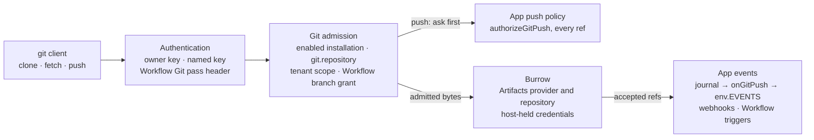

<!-- Generated by Botanical API docs (TypeDoc + typedoc-plugin-markdown). Do not edit. -->

**@fungi.computer/oyster**

---

# Oyster API overview

Oyster is built in layers. Most hosts need one import from the first table; the
rest of this page documents the building blocks those hosts are made of, how to
operate a deployed Oyster, and the low-level ports underneath. The generated
module pages that follow list every export.

## Choose a host

| Import                               | Export                                   | Use it when                                                                                                                |
| ------------------------------------ | ---------------------------------------- | -------------------------------------------------------------------------------------------------------------------------- |
| `@fungi.computer/oyster/standalone`  | the whole Worker                         | You want the full Oyster: git, Computers, Agents, Workflows, media, tenancy and App builds. Re-export it from `worker.ts`. |
| `@fungi.computer/oyster/workers`     | `createOysterWorker`                     | You want one owner's Apps from Releases, each in its own Durable Object with SQLite, plus MCP, and nothing else.           |
| `@fungi.computer/oyster/workers-git` | `oysterGitRoot`, `createOysterGitWorker` | You want that Worker plus the git door, keys, webhooks and Agents, composed once for HTTP, MCP and Instances.              |
| `@fungi.computer/oyster/host`        | `createOyster`                           | You run on another server or need your own adapters for sign-in, Releases, installations and Instances.                    |
| `@fungi.computer/oyster/pack`        | `packRelease`, `installRelease`          | You build an App from an exact commit and install its Release on any Oyster over HTTP.                                     |

`examples/standalone/wrangler.jsonc` declares every binding the standalone host
uses. A `createOysterWorker` host needs `LOADER`, `RELEASES`, `REGISTRY`,
`INSTANCES` and `MCP`, plus the `OYSTER_OWNER_KEY` secret and `OYSTER_ORIGIN`.

## Building blocks

| Import                                  | Export                                                                        | Purpose                                                                                                              |
| --------------------------------------- | ----------------------------------------------------------------------------- | -------------------------------------------------------------------------------------------------------------------- |
| `@fungi.computer/oyster/git`            | `EventSink`, `createGitDoor`, `signStandardWebhook`                           | The EVENTS binding contract, the git smart-HTTP door and Standard Webhooks signing.                                  |
| `@fungi.computer/oyster/mcp`            | `oysterAppMethods`, `oysterComputerTools`, `oysterMcpCatalogLoad`             | Installed App methods and the host's Computer as Mycelium modules for the shared MCP endpoint, scoped to the caller. |
| `@fungi.computer/oyster/apps`           | `Installation`, `applyInstallationCommand`, `admits`, `approvedBindingGrants` | Pure installation approvals and admission; host-owned commits and tenant freshness.                                  |
| `@fungi.computer/oyster/auth`           | `ownerKeyAuth`, `ownerOrKeyAuth`                                              | Owner-key sign-in (a Bearer key or the login cookie, compared in constant time) and named agent keys.                |
| `@fungi.computer/oyster/authorization`  | `routes`, route requirements                                                  | The one route table and its typed requirements.                                                                      |
| `@fungi.computer/oyster/tenant`         | `TenantScope`, `tenantScope`, `singleTenant`, `OysterTenancy`                 | Host-resolved tenant identity and the scope that prefixes registry, key and repository names.                        |
| `@fungi.computer/oyster/tenancy`        | `createTenancy` and its adapters                                              | Request resolution, a tenant registry and sign-in adapters (owner key, Auth0) for a multi-tenant host.               |
| `@fungi.computer/oyster/app-storage`    | `AppStorageBinding`, `createAppStorage`, `appStorageSchemaStatements`         | `env.APP_STORAGE` and its SQLite owner: declared keys, live admission, revision checks and watch invalidations.      |
| `@fungi.computer/oyster/agents`         | `OysterAgents`, `agentCapabilities`, `agentApprovalRoutes`                    | The host's Agent slot, its App capabilities and the owner-only approval routes.                                      |
| `@fungi.computer/oyster/computer`       | `computerSlots`, `ComputerTerminalHost`                                       | Computer ports, processes and terminal routes supplied by the host; execution stays in the Computer runtime.         |
| `@fungi.computer/oyster/files`          | `FileSource`, `fileCapabilities`                                              | Files Apps reach through Agar's `computer.*` file contracts, with a compare-and-swap replace.                        |
| `@fungi.computer/oyster/media`          | `mediaSlot`                                                                   | The media capability slot a host fills; Oyster owns routing, never generation.                                       |
| `@fungi.computer/oyster/browser`        | `createBrowser`, `browserCapabilitySource`                                    | The Agent browser over Cloudflare Browser Rendering: leases, URL policy, reaping and billing order.                  |
| `@fungi.computer/oyster/turnstile`      | Turnstile configuration and verification                                      | Cloudflare challenge configuration and token verification for a host's own challenged routes.                        |
| `@fungi.computer/oyster/build`          | `createAppCandidatePreparer`, `createLocalBuildExecutor`                      | Node-only source capture, pinned compilation and local artifact writing.                                             |
| `@fungi.computer/oyster/build-contract` | Recipe schemas and candidate orchestration                                    | The Worker-safe half of `./build`, without the executor.                                                             |
| `@fungi.computer/oyster/root-data`      | `createOysterRootData`                                                        | Installation and verified Release owners as shared workbench metadata for a standalone root.                         |
| `@fungi.computer/oyster/page`           | `mountOysterPage`, `connectOysterApp`, `readOysterPageConfig`                 | Mount one installed App's sandboxed frame and connect its admitted slots.                                            |

The lowest layer is one App Instance and the frame each request runs in:

| Import                              | Export                                                       | Purpose                                                                                          |
| ----------------------------------- | ------------------------------------------------------------ | ------------------------------------------------------------------------------------------------ |
| `@fungi.computer/oyster`            | `createAppInstance`, `InstancePorts`                         | Run one App Instance's lifecycle and admission over host-supplied ports.                         |
| `@fungi.computer/oyster`            | `selectionSchema`, `ownerStateSchema`                        | Decode the owner-issued selection and a complete owner state: `enabled`, `disabled`, `deleted`.  |
| `@fungi.computer/oyster`            | `AppInstanceError`, `instanceIds`                            | Typed rejection with a stable `code`; mint and recognize App Instance IDs.                       |
| `@fungi.computer/oyster/invocation` | `createInvocationGate`, `invocationFacts`, `InvocationFrame` | Run each request in one frame of host-admitted caller facts, with its deadline and abort signal. |
| `@fungi.computer/oyster/cloudflare` | `createCloudflareAppInstance`                                | Run an Instance in a SQLite Durable Object with a Worker Loader facet (workerd or celld).        |

The package's other entry points (`channels/*`, `boot-*`, `embed/*`,
`machine-link`, `agent-*`, `build-*`, `source`, `workflows`, `web` and
`testing`) are parts that the standalone host, the Fungi Hub and the first-party
Apps assemble. You do not need them to run or host Oyster.

## Deploy and operate

### Start a project without `try`

```sh
mkdir my-oyster && cd my-oyster
cat > pnpm-workspace.yaml <<'YAML'
allowBuilds:
  "@google/genai": false
  "@mongodb-js/zstd": false
  esbuild: true
  exifreader: false
  node-liblzma: false
  protobufjs: false
  workerd: true
YAML
pnpm add @fungi.computer/oyster @fungi.computer/computer react@^19.2.0 react-dom@^19.2.0
pnpm add -D wrangler
cp node_modules/@fungi.computer/oyster/examples/standalone/{worker.ts,wrangler.jsonc} .
export OYSTER_OWNER_KEY=$(openssl rand -hex 24)
printf '%s' "$OYSTER_OWNER_KEY" | npx wrangler secret put OYSTER_OWNER_KEY
```

The policy file lets esbuild and workerd install their native binaries and
disables unneeded dependency scripts. If `pnpm add` reports
`ERR_PNPM_IGNORED_BUILDS`, check that the file exists. If it names a new
dependency not listed there, review that package before allowing its scripts.
Then create the bucket, deploy and install the Apps as in the README.

`wrangler.jsonc` names the Worker `oyster`, its Release bucket `oyster-releases`
and its Artifacts namespace `oyster`. If you rename the Worker, update
`OYSTER_ORIGIN` to its URL at the same time. Without the `BROWSER` binding, a
Release's UI is reported `not_checked` with
`code: "boot_browser_binding_missing"` and the install still proceeds.

`install-apps` accepts `--ref` for a branch or tag of the App repositories,
`--repositories` for another host of them, `--timings <file>` to write the
timing table as JSON, and `--concurrency <n>` (default 2, on the example's
`standard-4` Computer with 12 GiB).

### Deploy with an API token

Load `CLOUDFLARE_API_TOKEN` into your shell without committing it, set
`CLOUDFLARE_ACCOUNT_ID` (or `account_id` in `wrangler.jsonc`) and skip
`wrangler login`. Use Wrangler 4.135.0 or newer. These account-scoped permission
groups cover deployment and teardown:

| Permission group         | Used for                                                    |
| ------------------------ | ----------------------------------------------------------- |
| Workers Scripts Write    | Deploy, secrets, Worker deletion and Workflow deletion      |
| Workers R2 Storage Write | Release bucket creation, object cleanup and bucket deletion |
| Workers Containers Write | Computer container application management                   |
| Artifacts Edit           | Artifacts namespace and repository management               |

The Workers `BROWSER` binding
[needs no additional permission](https://developers.cloudflare.com/browser-run/quick-actions/).
With an explicit account ID, do not add Workers KV Storage Read, User Details
Read or Memberships Read for account discovery. AI Gateway permissions are not
needed unless media has created a gateway you want to remove.

### Tear down

`npx wrangler delete` deletes the Worker, which deletes its Durable Object data,
not the whole Oyster. Also empty and delete the Release bucket, delete the
Computer's container application and the Workflow, and delete the Artifacts
repositories and namespace. Confirm each is gone in Cloudflare's dashboard or
API.

### Upgrade

Oyster's version is not Fungi's. Find the Oyster and Computer versions for your
Fungi release on the
[package versions page](https://docs.fungi.computer/reference/packages/), and
follow [Upgrade Oyster](https://docs.fungi.computer/guides/run-your-own-oyster/)
with the package manager and store that installed the project. Redeploy with the
same `npx wrangler deploy` command, then run `npx oyster install-apps`. If pnpm
stops with `ERR_PNPM_UNEXPECTED_STORE`, rerun with `--store-dir` set to the
store the error names.

Two older upgrades reset data rather than convert it. From before 0.7.0, the
installed Apps are cleared once: Oyster Home asks you to reinstall them with
`npx oyster install-apps`, which restores the Apps and their App settings, while
each App's own backend database starts empty. Agents, Sessions, files and keys
are kept. From 0.2 or earlier, Oyster answers every request with `409` and
`store_from_older_oyster`; deploy under new resource names or tear the old one
down first. The changelog entry for each release says when it resets data.

### Run on celld

The celld example is a limited trial, not the full Cloudflare setup, and needs
access to Fungi's private celld fork. Use
`examples/standalone/wrangler.celld.jsonc` beside `worker.ts`.

### Put an Agent on a website

Owner-only means only the owner signs in to Oyster; you can still put an Agent
on a public site. In Settings, choose Channels, then Add website: pick the
Agent, give your site's address and a brief, and paste the script tag Oyster
shows into that site:

```html
<script
  src="https://your-oyster.example/embed/v1.js"
  data-site="site_pk_…"
  data-theme="auto"
  async
></script>
```

Visitors are anonymous channel parties of that one Agent, never Oyster
principals, keys or App callers. They talk to the Agent with its own tools and
permissions plus the persona you wrote. Each site has its own key, allowed
origins, rate limits per visitor and per network address, and a pause switch; a
new site key stops the old code at once. The same page can require a Cloudflare
Turnstile check and shows the conversations.

The surface stays closed until you set two host secrets of at least 32 bytes
each: `OYSTER_WEBSITE_PROOF_KEY` signs a visitor's identity between the public
edge and the website Agent, and `OYSTER_WEBSITE_ADDRESS_KEY` salts the hashed
network address used for rate limits. For Turnstile, set `TURNSTILE_SITE_KEY`
and `TURNSTILE_SECRET_KEY`, or `TURNSTILE=off` for local use over `http`.
`@fungi.computer/oyster/turnstile` fails closed on HTTPS hosts without both
keys.

### Read a build's log

The owner reads a build's status at `GET /api/builds/:jobId` and its combined
stdout and stderr at `GET /api/builds/:jobId?log`. The status diagnostic stays
within 200 characters and points to the log. The log returns base64url-encoded
raw bytes; past 2 MiB it keeps the head and tail and reports
`truncated.droppedBytes`.

## Owner routes on the standalone host

These routes are owner-direct: they refuse App-origin requests, and Agents and
keys cannot use them.

**Agents.** `GET /agents` lists active Agents and `GET /agents?archived=true`
lists archived ones. `POST /agents/:agentId/archive` keeps existing Sessions and
reads but refuses new work with `contract/archived`, and pauses the Agent's
schedules; `POST /agents/:agentId/unarchive` resumes only the schedules archive
paused.

**Agent App tools.** An App with `agent.manage` can create Agents and request
tool-policy changes; those requests stay pending until the owner approves. Read
`GET /api/agent-policies/:agentId` for the current `expectedRevision`, then
`PUT` the same path with
`{"level":"write","expectedRevision":"<the returned revision>"}` (or `null` when
no policy exists). A stale revision returns 409, an unknown Agent 404 and
malformed input 400. The stored approval pins the owner's `membershipVersion`,
so demotion, removal or suspension requires new approval.

**Remote MCP servers.** Connect a Streamable HTTP MCP server once, then choose
which Agents use it; each sees its granted tools as `env.mcp.<name>.<tool>()`.
`GET /api/connections` returns the connections, their grants, the Agents and the
OAuth `callbackUrl`. `POST /api/connections` with
`{"name":"linear","url":"https://mcp.example.com/mcp","bearer":null}` creates
one; the name is up to 32 lowercase letters, digits or `_`, starting with a
letter, and the URL must be `https:` with no credentials or fragment. Set
`bearer` to a static token, or keep it `null` and add `oauth:{}` (optionally
with `clientId`, `clientSecret` and `scope`) and open the returned
`authorizeUrl` in your signed-in browser. A new connection grants nothing:
`PUT /api/connections/:connectionId/agents/:agentId` with `{"access":"read"}`,
`{"access":"all"}` or `{"access":["tool_name"]}` grants access,
`GET /api/connections/:connectionId/tools` lists tool names, and `DELETE` on
either path revokes. Credentials stay sealed on the owner side; Agents never
receive tokens. More than 16 connections per Agent, or a repeated name,
returns 409.

**App permissions.** After selecting a new Release, open **App access** beside
the App, or `/api/installations/<installationId>/grants`, review the requested
capabilities and choose **Save permissions**. The page sends a `PUT` carrying
the captured `storeGeneration`, `authorityVersion` and Release `artifactDigest`
with a `{kind:"change-grants",changes:[{capability,grant}]}` command; `null`
revokes a capability. A replaced store, stale Release or concurrent approval
returns `409`, and the page refreshes and rebases your edits. The required
`InstallationStore` exposes `generation()` and
`compareAndPut(record, expectedVersion, expectedGeneration)`, checking both pins
in one commit transaction.

**The Agents' browser.** With a `BROWSER` binding, every Agent gets a
`cloudBrowser` tool for public pages: `open`, `navigate`, `snapshot` (a bounded
accessibility-tree summary), `click`, `type`, `press`, `scroll` and `close`.
Every URL must be http(s), carry no credentials and resolve to a public address.
A standalone Oyster allows two open sessions, closes one after 5 idle minutes or
30 minutes in all, and Cloudflare bills the owner's account. Hosts compose
`@fungi.computer/oyster/browser` behind one `BrowserHost` port: a provider
(`bindingSessions(env.BROWSER)`, or `browserRunSessions` with a Browser Run
account token, which also enables the `markdown`, `links`, `scrape` and
`extract` reads), a metering owner and an event sink. The Agent never reaches
raw CDP or runs script in the page.

## Git

Git is one optional field of the typed host, `host.git`. When it is present,
`createOyster` mounts the git door at `/git/<installation>/<repo>.git`. There
are two ways to get it:

- **Use one git root.** `oysterGitRoot(options)` from
  `@fungi.computer/oyster/workers-git` composes the git door with tenancy,
  Agents and their owner-only approval routes, workspace and capability slots,
  the page script and the home App. Its `hostFor(env, scope)` is the only way a
  tenant host is built. Pass the root to `createOysterGitWorker` for HTTP and to
  `createOysterGitMcpOwner` for MCP, and return `root.hostFor(this.env, scope)`
  from your `OysterGitInstance` subclass, so HTTP, MCP and background wakes
  share one composition. A single-owner root passes `ownerOrKeyTenancy`.
- **Set `host.git` on your own host.** Keep your own `createOyster(host)` and
  set `git: oysterWorkerGit(env, { scope })` and
  `ownerRoutes: gitAdminRoutes(env, scope)` for `/api/keys` and `/api/webhooks`,
  with the tenant `scope` your host selected.

```ts title="worker.ts"
import type { TenantScope } from "@fungi.computer/oyster/tenant";
import {
  createOysterGitMcpOwner,
  createOysterGitWorker,
  OysterGitInstance,
  oysterGitRoot,
  ownerOrKeyTenancy,
  type OysterGitWorkerEnv,
} from "@fungi.computer/oyster/workers-git";

const root = oysterGitRoot<OysterGitWorkerEnv>({ tenancy: ownerOrKeyTenancy });

export class OysterMcp extends createOysterGitMcpOwner(root) {}

export class OysterInstance extends OysterGitInstance {
  protected hostFor(scope: TenantScope) {
    return root.hostFor(this.env, scope);
  }
}

export default createOysterGitWorker(root);
```

A git host also exports the Durable Objects and the `OysterBinding` entrypoint,
whose table serves `env.GIT` and `env.EVENTS`, and its Wrangler config adds the
`ARTIFACTS` binding and the `KEYS` and `WEBHOOKS` Durable Objects. The package's
`test:git-door` check runs this root on workerd against real bare repositories.

Each layer of a push owns one decision:



- **Authentication** is the host's own `auth`. The owner key is a Bearer token;
  a named key may also be the Basic password from a git credential helper. A
  clone needs App read and a push needs App use. Anonymous requests never clone
  or push.
- **Git admission** reopens the live installation before every provider call: it
  must be enabled and its Release must declare `git.repository`. The tenant
  scope prefixes every repository name (`<installation>--<repo>` for the default
  tenant), so an installation reaches only its own repositories.
- **The App's push policy** answers `authorizeGitPush` for every ref update
  before any bytes reach the provider. One refusal rejects the whole push with
  git's native `ng` report. Unsupported receive-pack commands, including signed
  push certificates, fail closed.
- **Burrow** owns the provider and the repository. The host's Artifacts adapter
  mints short-lived credentials through it and forwards the admitted smart-HTTP
  exchange, up to 64 MiB per request. The App never sees a credential or remote.
- **App events** start from the accepted-ref journal. Delivery calls the
  Instance's `onGitPush` when the Release declares `receives: ["git.push"]`. The
  App emits typed events through `env.EVENTS`, which Oyster delivers as signed
  Standard Webhooks and as Workflow triggers on hosts with Workflows.

An App's own `GIT` binding (`await env.GIT.cloneUrl(repo)`, create, fork, log,
read and merge) uses `admitted.binding(onBehalfOf)`. Its writes skip the App's
external-push policy but keep live host admission and enter the same journal.
The journal records only refs the provider accepted and commits before the
exchange is acknowledged; redelivery keeps the original fact and `eventId`, so
handlers record that ID with their effects. Hosts compose one
`createAdmittedGit` with an installation-scoped store, live grants, the App's
`authorizeGitPush` policy and a journal; `createGitPushJournal` is the
standalone one, committing the fact, ref tips and its Carrier send together.
`GitWriter`, `GitPushQuestion` and `GitPushVerdict` come from
`@fungi.computer/agar/git`.

`createGitDoor` from `@fungi.computer/oyster/git` takes the host's
`authenticate`, `isPublic` and `git` ports directly; `createOyster` builds them
from `host.auth`, `host.installations` and `host.git`, so most hosts never call
it.

A host whose Workflow run owner issues Workflow Git credentials supplies
`workflowGitPass` in `oysterGitRoot` or `oysterWorkerGit` options. Each
credential covers one native command of an admitted Git step, travels only as an
`Authorization: Bearer wgp.…` header (never in a URL), is admitted for one
repository and the Workflow's branch grant, and stops working when its command
closes or its run ends.

## App capabilities

Each `OysterCapability` supplies its Agar `id` and `version`, a mount `base`,
relative declared `routes` (a `routes()` table from
`@fungi.computer/oyster/authorization`, where every route names its requirement:
`owner`, `agent`, `computer`, `member`...), and `methods`. Each method has a
`kind` (`json`, `transport`, `read` or `write`), an HTTP `method` and a relative
`path`. JSON calls return decoded data, transports return Fetch handles, and
reads and writes return Agar's stream handles. For example, a directory listing
is `{ kind: "json", method: "GET", path: "list" }`, and
`fileCapabilities(source)` from `@fungi.computer/oyster/files` supplies the
three file contracts.

Method paths may contain named parameters such as `:agentId/sessions`; Oyster
compiles input fields into them with `path-to-regexp`, and remaining scalar
fields become query parameters for GET and handle calls. Transport handles may
declare `method: "ANY"` to keep the request's HTTP method. Results, including
Agar's `{ kind: "pending", retryAfterMs }`, reach the App unchanged.

The page offers a capability only when the installed Release declares its ID and
`admits` allows the principal, and every route request rechecks both. Consent
approves capabilities, like OAuth scopes: an upgrade may add a method under an
approved capability without asking again, but a new capability always needs
approval, and each Worker call receives only the bindings its method's
`requires` allows. The `apps.call` permission also shows the target Apps and
methods it names; changing a target method needs approval, and the target
receives its own grants, never the caller's.

## MCP and Agent tools

Connect an MCP client to `https://<your-oyster>/mcp` with
`Authorization: Bearer <key>`. Installed App methods are available through
`execute` as `env.<APP>`, a dotted method is a nested property
(`env.BONSAI.repos.list({})`), and `forage.search` and `forage.describe`
discover them. A key's App writes run under the owner's approval recorded when
the key was created, so a headless client such as `claude -p` can write. Every
other write, including the owner's own calls, needs a client that supports form
elicitation; anonymous callers are refused.

When the host has a Computer, the catalog also holds it as
`env.computers.workspace`, with the operations every Computer advertises
(`read`, `list`, `write`, `mkdir`, `bash`, `exec` and the process tools). Each
call asks for approval. `oysterComputerTools(host, principal)` returns that
Knapsack source and its grants.

Workers route every MCP request to the tenant's `MCP` Durable Object: export
`OysterMcp` from `oyster/workers`, or derive it from
`createOysterGitMcpOwner(root)`. SDK sessions belong to the authenticated owner;
after a restart that loses the live transport, the old session ID returns 404
and the client initializes a fresh one. Pending execution and elicitation are
never replayed.

Agent and key adapters call `await oysterAppMethods(host, principal, access)`
from `@fungi.computer/oyster/mcp` and pass the result in Mycelium's `sources`.
Its `grants` names each module at the level (`read` or `write`) the caller
holds, so Mycelium refuses a write to a read-only module up front. For an Agent,
`access` is `{kind: "agent", policy}`, the owner's one stored approval; for a
named key it is `{kind: "key", keyId, byInstallation}`, one approval per
installation the key's grants admit, and other installations are not listed at
all. A key's grants are fixed at `POST /api/keys`; to change them, revoke it
(`POST /api/keys/revoke`) and issue a new one. `external` methods are refused
with `approval_required`. Capture again when tool policy, installation
authority, a key's grants or a Release changes.

## Pack and build App Releases

`packRelease` from `@fungi.computer/oyster/pack` builds an App from one commit.
Pass the repository root as `sourceDirectory`, an explicit `sourceRevision`
(`git:<full commit SHA>`) and a `recipe` whose paths are relative to that root;
dirty files and external build outputs are not inputs. This packs the Notes
example App kept at the root of its own repository, `./notes-app`:

```ts
import { execFileSync } from "node:child_process";
import { packRelease } from "@fungi.computer/oyster/pack";

const commit = execFileSync("git", ["-C", "./notes-app", "rev-parse", "HEAD"], {
  encoding: "utf8",
}).trim();

await packRelease({
  appId: "app_notes",
  sourceDirectory: "./notes-app",
  sourceRevision: `git:${commit}`,
  recipe: {
    entry: "ui/index.html",
    assets: {
      maxManifestBytes: 1_048_576,
      maxObjects: 1024,
      maxObjectBytes: 16_777_216,
      maxTotalBytes: 67_108_864,
    },
    assetBase: "./",
    maxOutputBytes: 67_108_864,
    backend: {
      entry: "backend/index.ts",
      exportName: "Notes",
      compatibilityDate: "2026-09-04",
      runtime: { kind: "durable-facet", stateSchema: 1 },
    },
  },
  outDirectory: "./notes-release",
});
```

The result holds `release.json` and `artifacts/`. Install it with
`oyster install ./notes-release --installation-id notes` (with `OYSTER_URL` and
`OYSTER_OWNER_KEY` set) or `installRelease`, which uploads the artifacts and
makes one `POST /api/installations`: 201 for a new installation, 200 when it
switches an existing one to the Release, keeping its data. `installFromSource`
captures a commit from an Artifacts remote, builds it the same way and installs
it, keeping source credentials and the owner key separate.

The compiler reads the nearest package's `fungi.app` declaration, plus
`fungi.backendDefinition` for Apps with a backend, and derives the API from that
definition; handwritten package API methods are refused. An App keeps its recipe
in `package.json#fungi.build`, with paths relative to the App's directory:
`readBuildManifest(packageJson)` decodes it and
`appBuildRecipe(manifest, directory)` roots it for a captured checkout. Unknown
build fields are refused, and the recipe policy is pinned as
`package-json-fungi-build-v4`.

Recipes come in two kinds. A closed source HTML recipe (no `kind`, an entry such
as `ui/index.html`) installs the captured lockfile with the pinned
`pnpm@11.24.0` and no lifecycle scripts, builds the workspace TypeScript
projects and stylesheets it imports, and builds the HTML with Vite; its package
must be a pnpm workspace member or a standalone repository root. A
`kind: "bundled-html"` recipe accepts committed, ready assets such as
`bundle/index.html`. Both require an explicit `assets` policy; set
`backend: null` for a UI-only App. A workspace dependency that cannot build from
its `tsconfig.build.json` may name one package script,
`"fungi": { "build": { "script": "build" } }`, which runs only in a Computer
build; every other composition, including `packRelease`, refuses it.

`@fungi.computer/oyster/build` is the Node half:
`createLocalCommitSourceCapture` captures a commit, `createAppCandidatePreparer`
builds it with `createLocalBuildExecutor`, `createLocalArtifactWriter` writes
the objects, and
`createArtifactsSourceCapture({ remote, token, sourceRevision })` captures an
exact commit from an Artifacts remote. `@fungi.computer/oyster/build-contract`
is the Worker-safe half: recipe schemas, normalization, digests and
orchestration, with no filesystem, subprocess or compiler imports. Builds run in
the host's trusted build environment, never inside a request handler.

**Builds on the standalone host.** Bonsai's repository Settings **Make this an
App** (or `APPS.register({ repo })`) registers a repository from the committed
root `package.json#fungi.build`; callers cannot override its identity or recipe.
`APPS.buildStatus({ repo })` or `APPS.buildStatus({ jobId })` reads a build. An
accepted push to main starts the Trellis build-on-merge Workflow, which builds,
verifies the source and installs within existing grants. New permissions, and
every fresh installation, return `needs_consent` until the owner selects the
built Release directly; Workflows can update an installation but never widen its
grants. `apps.install` and `APPS.select` need the successful build's `jobId`
alongside `installationId` and `release`.

## The shell

The shell client lives in its own package,
[`@fungi.computer/nacre`](https://github.com/fungi-computer/nacre): workbench
host, command host, keys, commands, window manager and the shell-module
contract. `@fungi.computer/oyster/page` mounts one installed App's sandboxed
frame; menus, the command palette and every other piece of desktop chrome belong
to the shell.

A shell is not a framed App. When the owner opens the home installation, the
host's page script renders the shell in the top-level document with the host's
permissions: it reads the installation directory and opens, arranges and closes
every App. Choose a shell you trust, as you would the host. Child Apps stay
isolated: `WorkbenchHost.mount(container, launch, events)` mounts each in its
own sandboxed, cross-origin frame inside a slot the shell owns, and nothing
granted to the shell is lent to them. A minimized window keeps its frame
mounted, so restoring it never reloads the App. Read the home installation's
handles with `oysterShellHandles(readOysterPageConfig())`, and connect each
child frame with `connectOysterApp`.

Oyster core imports no home App: it serves the selected enabled installation, or
its installation list when there is none. `@fungi.computer/oyster/root-data`
adapts the installation and verified Release owners into workbench metadata. The
workbench host's `memberAvatar()` is a read-only projection of the signed-in
member's avatar preference.

## Core concepts

### Authorization

`@fungi.computer/oyster/authorization` is Oyster's one authorization owner.
Every route is registered through `routes()` with a typed requirement
(`publicRoute`, `door`, `owner`, `member`, `app`, `apps`, `agent`, `agents`,
`computer`), and an undeclared route is not served. The owner reaches
everything. A named key reaches exactly its Ear Tag grants: `apps.read` or
`apps.use` per installation (including that App's git repositories),
`agents.use` per Agent, and `computer.use` for the Computer, its files and
media. An Agent reaches its approved App tool policy, and nothing anonymous
reaches an App. `owner("direct")` refuses App-mediated requests, so consent,
keys and secrets never ride an App.

A browser signs in only with the owner key, through `/login` and its
`SameSite=Strict` session cookie; named keys sign in only by header. Anonymous
requests reach only `/login`, `robots.txt`, digest-pinned shell and App UI bytes
and the website chat.

### Owner state and selection

Oyster is not admission: the host decides who may install, enable or call an
App, then calls `apply` with the complete owner-issued state and `fetch` or
`call` with the admitted selection. Both identify the Instance, owner, App,
Release and authority version. Oyster persists the version the owner supplied
and never trusts a guest's claim to it.

| Owner state | Runtime behavior                                                |
| ----------- | --------------------------------------------------------------- |
| `enabled`   | Resolve and activate the eligible backend.                      |
| `disabled`  | Fence new requests and abort connections while retaining state. |
| `deleted`   | Record deletion, abort, purge state and retain a tombstone.     |

An exact retry returns its recorded result, changed input at the same version
conflicts, and older versions are stale. A same-schema Release replacement keeps
backend state; a changed schema fails with `state_schema_migration_unsupported`.
Deletion persists `deleting` before purge and `deleted` afterwards, and a later
access resumes an interrupted purge.

### Instance ports

`createAppInstance` is the Effect core. Its host supplies `read`, `write`,
`resolve`, `abort`, `purge` and `connect` for one Instance ID. `resolve` returns
the selected Release's verified backend: runtime profile, state-schema version,
compatibility date, export name and bundled ESM under an immutable digest.
Admission takes the lifecycle lock while acquiring a connection but not while
waiting on App code, so disable and delete can abort in-flight work.

### Scoped App storage

`createAppStorage` from `@fungi.computer/oyster/app-storage` is the SQLite owner
for declared App keys. Supply the database connection and an atomic `commit`;
`open(authorize)` binds a member view and `openInstallation(authorize)` binds
lifecycle work to the shared team layer. Each operation rechecks live admission,
and writes check the expected revision, declared scopes, size and quotas. After
commit, `events(key)` publishes bounded invalidations. Installation and
membership deletion use `purgeAppStorageInCommit` and
`purgeAppMemberStorageInCommit` inside the caller's transaction. A backend
receives `env.APP_STORAGE` only for operations its declaration and grants admit,
through the `OysterBinding` entrypoint the Worker exports.

### Durable Object composition

`createCloudflareAppInstance` keeps supervisor state in a SQLite Durable Object
and runs the backend in a named `app` facet loaded through the Worker Loader; a
new Release keeps that facet's database. The loader key includes the Instance ID
and artifact digest, so Instances of one Release never share guest module scope.
Guest code receives only the `bindings()` its host builds, with no ambient
outbound access.

Activation is checked before it is selected: the candidate backend loads in a
unique isolate over a disposable `candidate` facet (a copy of `app` for an
initialized Instance) with denied bindings and no network, and the host opens
the immutable UI entry in a zero-grant browser session (`checkBootPage`). The UI
result is reported, never authority: `failed` when the page did not mount,
`not_checked` when no browser, a timeout or unconfirmed cleanup prevented the
check. The copy is a construction test, not a backup.

One Instance shares its guest between up to eight verified reads; writes, raw
requests and supervisor work run alone. Guest work runs only while a frame on
that Instance is admitted, and stopping the guest never erases its database.

### Guest execution policy

`createOyster({ ...host, guestLimits: { cpuMs: 250, subRequests: 10 } })`
configures per-invocation budgets. Omitted fields default to 1,000 milliseconds
of CPU and 50 subrequests. CPU must be a positive integer; subrequests may be
zero to forbid them. Invalid configuration fails before accepting requests.
`createOysterWorker({ guestLimits })` wires this for the standalone Worker, and
direct `createCloudflareAppInstance` callers pass it in its final argument.
Changing an Instance's budgets restarts its facet and keeps its SQLite state.
Runtime enforcement uses the
[Worker Loader resource limits](https://developers.cloudflare.com/dynamic-workers/usage/limits/).

Guest HTTP responses keep only content metadata: content type, language,
encoding, length, disposition and range, accepted ranges, ETag and
last-modified. Oyster adds `Cache-Control: no-store`,
`X-Content-Type-Options: nosniff` and a sandboxed, deny-by-default Content
Security Policy. Cookies, redirects and other headers cannot come from guests.

### Hosting many tenants

Pass your own `OysterTenancy` from `@fungi.computer/oyster/tenant` as
`oysterGitRoot({ tenancy })`. Its `resolve(request)` selects one tenant from the
request origin before sign-in and returns that tenant's `TenantScope` (built
with `tenantScope(tenantId, origin)`) and authentication, or `null` to refuse an
unknown origin. Oyster uses the scope for registry, workspace, keys, webhooks
and repository names, and pins each Instance to its tenant. `ownerOrKeyTenancy`
is the single-tenant case.

## Contract changes

- **App `AGENTS.send`** requires a caller-owned `requestId`, non-empty and at
  most 256 UTF-8 bytes. Mint it once per user intent and retry an UNKNOWN
  outcome with the same input unchanged; the recipient may already have accepted
  it. Grove's `sendMessage` requires and forwards the same field.
- **Build recipes** come from the selected source's `package.json`:
  `standaloneAppSet` no longer carries `StarterApp.recipe`; read it with
  `readBuildManifest` and `appBuildRecipe`. Builders refuse metadata under any
  policy other than `package-json-fungi-build-v4`.
- **Repository registration** is repo-only `APPS.register({ repo })`; the
  `PUT /api/apps/:appId/build-source` route is gone.
- **Installation from a build** (`apps.install`, `APPS.select`) needs the
  build's `jobId`.
- **Five internal entry points are no longer exported:** `app-builds`,
  `app-sources`, `catalog-frame`, `standalone/visitor-edge` and
  `apps/permissions-port`. They were parts of the standalone host with no
  outside callers; use the composed hosts above.

```ts
const intent = {
  agentId,
  sessionId,
  requestId: crypto.randomUUID(),
  text: "Continue this work",
  delivery: "followUp" as const,
};

const accepted = await env.AGENTS.send(intent);
// If the outcome is UNKNOWN, retry env.AGENTS.send(intent), unchanged.
```

## Drive one Instance in memory

This self-contained example drives one Instance through in-memory ports. A
disabled Instance never resolves or connects a backend, so no Release is needed.
The request runs in a frame from `createInvocationGate`, the same gate the
standalone Instances and the Hub open for every call.

```ts
import * as Effect from "effect/Effect";
import * as Schema from "effect/Schema";
import {
  AppInstanceError,
  createAppInstance,
  instanceIds,
  ownerStateSchema,
  type Instance,
} from "@fungi.computer/oyster";
import {
  APP_INVOCATION_CEILING_MS,
  createInvocationGate,
  invocationFactsSchema,
} from "@fungi.computer/oyster/invocation";

const instanceId = instanceIds.instance.generate();
let stored: Instance | null = null;
const instance = createAppInstance({
  instanceId,
  read: () => Effect.succeed(stored),
  write: (record) =>
    Effect.sync(() => {
      stored = record;
    }),
  resolve: () => Effect.fail(new Error("No Releases in this example")),
  abort: () => Effect.void,
  purge: () => Effect.void,
  connect: () => Effect.fail(new Error("No backend in this example")),
});

const selection = {
  instanceId,
  owner: { kind: "installation", id: "installation_example" },
  appId: "app_example",
  releaseId: "rel_example",
  authorityVersion: 2,
} as const;
const disabled = Schema.decodeUnknownSync(ownerStateSchema)({
  ...selection,
  status: "disabled",
});

const receipt = await Effect.runPromise(instance.apply(disabled));
console.log(receipt.status); // "disabled"

// A request runs inside an invocation frame: the caller facts the host admitted,
// a deadline, and an abort signal the gate owns.
const gate = createInvocationGate<null>({
  abortGuest: () => Promise.resolve(),
  close: () => Promise.resolve(),
});
const facts = Schema.decodeUnknownSync(invocationFactsSchema)({
  instanceId,
  selection,
  artifactDigest: `sha256:${"0".repeat(64)}`,
  subject: {
    kind: "call",
    context: {
      actor: { kind: "member", memberId: "member_example" },
      computerId: null,
    },
  },
  grants: [],
  ancestry: [],
  deadlineAt: Date.now() + APP_INVOCATION_CEILING_MS,
});
const refused = await gate.run(facts, null, (frame) =>
  Effect.runPromise(
    Effect.result(instance.fetch(frame, new Request("https://app.test/"))),
  ),
);
if (refused._tag === "Failure" && refused.failure instanceof AppInstanceError)
  console.log(refused.failure.code); // "instance_inactive"
```
